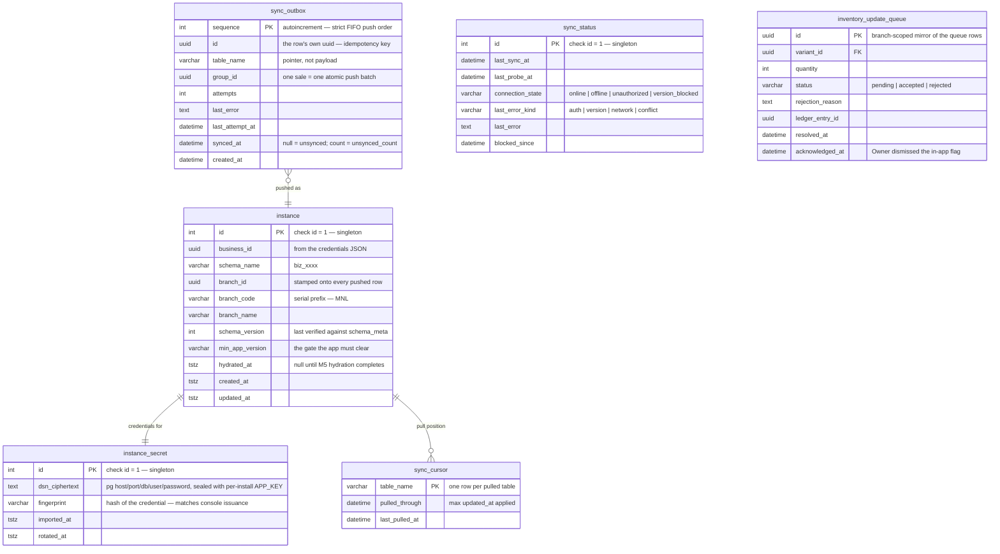

# MULTIBRANCH-BRAINSTORM.md

# Evitan Plus — Multi-Branch, Provisioning Console & Sync

> This document is the functional spec for the **multi-branch initiative**: evolving the
> single-install **Evitan POS** (`v1.0.0`) into **Evitan Plus**, a **multi-branch,
> cloud-connected** product backed by Supabase (Postgres), plus a **developer-only
> Provisioning Console** that oversees every business.
>
> It is the sibling of the original `BRAINSTORM.md` (the offline single-install MVP spec).
> Where the two disagree on multi-branch/sync matters, **this document wins**; where this
> document is silent, the original invariants in `BRAINSTORM.md` / `CLAUDE.md` still hold.
>
> **Scope of this first deliverable:** the Provisioning Console, the online business schema,
> the branch device's cloud connection, the developer-run setup wizard, and the
> **connection/sync engine** (bidirectional sync, status/heartbeat monitoring, and
> Owner-facing consolidated cross-branch reporting). The full column-by-column sync mapping
> of *every* auxiliary table is refined during the build; the core loop is in scope now.
>
> **Reading the "As built" annotations.** Blockquotes marked **As built** record where the
> implementation deliberately diverged from the prose above them, and why. Where one appears,
> **it wins** — the original prose is kept unchanged so the intent stays legible, but it is
> no longer a description of the system. Each names the phase that made the call; the full
> reasoning and its test coverage live in that phase's note in `MULTIBRANCH-ROADMAP.md`.
>
> **Vocabulary.** `docs/glossary.md` is **normative** for the terms used here, and outranks
> this document where the two disagree about what a word means. Read it before writing a phase
> against this spec: several of the "As built" notes below exist only because a word meant one
> thing in this prose and another in Postgres. Words with a defined meaning that is easy to
> assume wrong — *till*, *branch device*, *mirrored*, *readable*, *pulled*, *outbox* vs
> *queue*, *app version* vs *schema version*, *revoke* vs *delete*, *credential* — are defined
> there once, with the code that anchors each.

---

## 1. Overview & goals

**Evitan POS** (`v1.0.0`) is a self-contained offline app for **one business installation**.
**Evitan Plus** keeps that offline resilience but makes the app the client of a **per-business
Postgres schema** on Supabase, so a single business can run **multiple branches** that share
one authoritative dataset, while the developer operates a console that provisions and monitors
every branch.

> The two names are **different products**, not old and new spellings of one — see
> `docs/glossary.md` §1. Evitan POS remains a released artifact with its own application id and
> its own on-disk data directory; an Evitan Plus build does not adopt an Evitan POS install's
> data (`RELEASE-NOTES.md`).

**Primary goals**

1. **Never stop the business.** A branch keeps selling (POS, returns, defects, login/logout,
   local audit) even with no internet. This is the reason SQLite stays on every device.
2. **One authoritative dataset per business.** Postgres (one schema per business) is the
   source of truth for catalog, users, settings, inventory adjustments, and cross-branch
   reporting.
3. **Developer-operated onboarding.** The developer provisions the business, prepares the
   hardware/OS, installs the AppImage, and runs the setup wizard. The business receives a
   **turnkey device**.
4. **Least-privilege, per-branch isolation.** Each branch connects with its own Postgres
   role that can only touch its business's schema, and cannot delete immutable history.
5. **Central oversight.** The developer console can provision, migrate, rotate credentials,
   enable/disable, and monitor every branch's version and sync status.

**Explicit non-goals for this deliverable** — deferred, and **not designed around**. If one of
these is ever needed it gets designed then, against the system as it actually exists. An earlier
draft required that "the design must not preclude them", which sounds free and is not: it quietly
funds structure today for features that may never be built, and one person maintains everything
built under it.

- Multiple POS tills per branch (MVP is **one device per branch**).
- A live push/command channel from console to branch (Supabase Realtime) — status is
  polled from a per-schema status table for now.
- OS-level network-change listeners (we use a webview signal + probe + one poll — see §11).

---

## 2. Product framing & who touches what

| Actor | Touches | Never touches |
|---|---|---|
| **Developer (you)** | Provisioning Console; hardware/OS prep; build install; setup wizard; schema migrations; credential rotation; monitoring | — |
| **Business Owner** | In-app screens: login (pre-created Owner), POS, in-app admin screens (inventory, users, settings, reports incl. consolidated cross-branch) | Provisioning Console, setup wizard, DB credentials |
| **Admin / Cashier** | In-app POS + permitted in-app screens | Provisioning Console, setup, credentials |

> **Three unrelated things are called "admin" in this document**, and the difference decides who
> can do what (`docs/glossary.md` §1):
>
> - **Admin** — a *permission role*, one rung below Owner (`app/Enums/UserRole.php`).
> - **The in-app admin screens** — the business's own management UI. A *surface*, not a person;
>   an Owner uses them too. Where a rejected inventory adjustment is flagged (§10).
> - **The console admin connection** — the console's privileged Postgres login that owns all
>   DDL and role management. Never present in a shipped build (§18).
>
> "Role" is likewise two systems: a **permission role** (Owner/Admin/Cashier, app-enforced,
> per-user) and a **branch role** (a Postgres login, per-branch, not user-aware). §6 depends on
> them staying apart. Only the **Developer** appears as an actor here — "operator" elsewhere in
> this document means the same person, and survives only as the console's audit identity string.

**The onboarding chain is entirely developer-run** — *onboarding* is the whole chain,
*provisioning* only its first step:

```
Provision business (console)  →  configure hardware/OS  →  place AppImage on device
     →  run setup wizard (import JSON, connect, hydrate)  →  hand over turnkey device
```

The business simply powers on a ready device and logs in as the Owner that was created
during provisioning.

---

## 3. Architecture at a glance

```
┌──────────────────────────────┐        ┌───────────────────────────────────────────┐
│  Provisioning Console         │        │  Supabase (Postgres)                        │
│  (developer-only, own app,    │ admin  │  ┌─────────────────────────────────────┐   │
│   NOT shipped in any build)   │───────▶│  │ schema biz_<id>  (one per business) │   │
│                               │  DDL   │  │  users, categories, items, variants,│   │
│  - provision business/branch  │        │  │  prices, settings, branches,        │   │
│  - migrate schemas            │        │  │  transactions, transaction_items,   │   │
│  - rotate / disable / delete  │        │  │  inventory_ledger, stock_snapshots, │   │
│    branch DB roles            │        │  │  returns, defects, login_history,   │   │
│  - monitor versions & sync    │        │  │  audit_logs, inventory_update_queue,│   │
└──────────────────────────────┘        │  │  branch_status                      │   │
                                         │  └─────────────────────────────────────┘   │
                                         │   Postgres ROLE per branch (least-priv)     │
                                         └───────────────────────────────────────────┘
                                                        ▲  bidirectional sync
                                                        │  (push insert-only history,
                                                        │   pull catalog/users/stock,
                                                        │   process inventory queue)
                                         ┌──────────────┴───────────────┐
                                         │  Evitan Plus branch device    │  (one per branch)
                                         │  custom NativePHP binary      │
                                         │  ┌──────────────┐             │
                                         │  │ SQLite (local│  offline    │
                                         │  │ branch-scoped│  writes +   │
                                         │  │ mirror + out-│  read cache │
                                         │  │ box + queue) │             │
                                         │  └──────────────┘             │
                                         └───────────────────────────────┘
```

- **Custom NativePHP binary**: ships with both **SQLite** (offline) and **pgsql** (online)
  drivers. The `pgsql` connection already exists in `config/database.php`; the binary is
  supplied by the developer and dropped in when needed.
- **One Postgres schema per business.** The schema holds **all branches** and all business
  data. A business never spans more than one schema.
- **One Postgres role per branch**, least-privilege, scoped to that business's schema only.

> **As built (M1).** The table list inside the diagram is the design's vocabulary, not the
> schema's — `prices`, `returns` and `defects` do not exist as tables, and three tables it
> omits do. See §5's annotation for the real set.

---

## 4. Non-negotiable invariants (this initiative)

These extend the original invariants in `CLAUDE.md`/`BRAINSTORM.md`, which all still apply
(immutable history, append-only ledger, ledger-derived inventory, never delete business
records, UUID PKs, one Owner, Item Cost Owner-only, negative inventory never allowed, etc.).

**Offline-first, never stop selling**
- Offline-capable writes (POS sales, returns, defects, login/logout, local audit) always
  commit to **SQLite first** and are synced afterward — the network is **never** in the
  checkout hot path, online or offline.
- A sync failure, an authorization failure (disabled role), or a version mismatch **never**
  stops the till from selling. Work queues locally and flushes later.

**Single-writer per table (no edit-edit conflicts)**
- Every mirrored table has exactly **one writer**. Online-authoritative tables
  (catalog, users, settings, inventory adjustments) are written **only** online and pulled
  down read-only. Local-write tables (sales, transaction_items, returns, defects,
  login_history, local audit) are written **only** on the till, are append-only/immutable,
  and are pushed **insert-only** keyed by UUID (idempotent re-push).
- There is therefore **no last-write-wins** anywhere. See §10 for the one shared quantity
  (stock), which reconciles **additively**, not by conflict resolution.

**Negative inventory never crosses the online/offline boundary**
- Real, immutable local movements (sales/returns/defects that already happened) always win.
- Online, branch-targeted inventory **adjustments** are mediated through an
  **inventory update queue** and only applied when they keep reconciled stock `≥ 0`.
  An infeasible subtractive adjustment is **rejected and flagged in the in-app admin**
  (the business's own screens — *not* the Provisioning Console). See §10.

**Per-branch continuous serial**
- The transaction number is a **per-branch** continuous, gapless, zero-padded running serial
  with a branch prefix (e.g. `MNL-0000000001`). It never resets and is generated locally so
  it works fully offline. Business-wide uniqueness comes from the branch prefix. See §12.

**Isolation & least privilege**
- A branch role can only reach **its own business's schema**. It has **SELECT + INSERT**
  where it reads/appends and **UPDATE** only on the few mutable rows (its `branch_status`
  row, `stock_snapshots`, and `inventory_update_queue` status). It has **no DELETE** — DB
  grants enforce immutability, not just app logic and triggers.

> **As built (M2).** Two qualifications, both load-bearing:
>
> - The `inventory_update_queue` grant is **four columns**, not `status` alone — see §7.
> - The isolation this bullet promises is **schema-level, not row-level**. Within its own
>   business schema, a compromised branch credential can insert rows tagged with *another
>   branch's* `branch_id`: a grant cannot see row contents. Row-level security would be the
>   mitigation and is **deliberately not planned** — an accepted risk, with the reasoning in
>   `docs/glossary.md` §9. Read this invariant as "one business cannot reach another
>   business's data" — it is not "one branch cannot forge another branch's data."

**The Provisioning Console never ships**
- Console code and its powerful admin credentials must never appear in any AppImage/deb/build.
  This is enforced **structurally** (separate app, not referenced by the build) plus
  defense-in-depth env cleanup. See §18.

**Auditability everywhere, including the console**
- All in-app significant actions still audit (as today). The **Provisioning Console also
  audits its own actions** (provision, migrate, rotate, disable, delete) to a developer-side
  provisioning audit log.

---

## 5. Data model — who writes what

Tables fall into three classes. The class determines sync direction and grants.

### 5.1 Online-authoritative (pulled down, read-only on the till)
Edited **only** online (Provisioning Console or in-app admin while online); the till mirrors
them for offline reads and **never** edits them locally.

> **As built (M6.5): that last clause was a claim about the app, not a description of it, and
> it cost this initiative a whole phase.** The till *did* edit these tables locally — Item,
> Category, User and Settings CRUD have written to local SQLite since v1.0.0, and still do.
> What M6.5 changed is where the write *also* goes.
>
> The sentence should read: these tables are edited from the in-app admin **while online**, and
> every such edit is written to Postgres and the local mirror **as one atomic act** — an
> **online write** (`docs/glossary.md` §5, `App\Support\Sync\OnlineWrite`). Offline the screens
> refuse; reading is untouched and stays fully offline.
>
> Two consequences that were not obvious while the false claim stood:
>
> - **The branch role needs INSERT and UPDATE on these tables**, which it did not have. §5.1
>   asserted an operation the credential could not perform, so the feature was unreachable and
>   the rows went nowhere — silently. See §7's As-built note for what that costs.
> - **"Online-authoritative" is not one bucket.** `branches` and `schema_meta` stay refused to
>   a branch role: a branch may not invent branches, rename itself, or move the floor the
>   version gate compares against. Only the catalog, users and settings opened up.
>
> How a sentence like this survives three phases is worth recording: it reads as a design
> constraint, so every later phase treated the case as impossible rather than unbuilt.

- `categories`, `items`, `variants`, `prices` — the shared **catalog** (mirrored in full).
- `users` — mirrored **business-wide** (all users' credential hashes on every device) so
  **any user can log in offline at any branch** (see §6). Still one Owner; Item Cost stays
  Owner-only at the app layer.
- `settings`, business identity, `branches` (branch identity/codes).
- `inventory_ledger` rows of type **restock / manual adjustment / import** (stock-ins and
  online adjustments) — see §10 for how adjustments are mediated.

> **As built (M7): two of these are pulled tables that `Puller` deliberately does not read.**
> `branches` has no local counterpart at all — branch identity lives in `instance`, written once
> from the credentials JSON, and no console command renames a branch or sets `disabled_at`, so a
> pull would have no consumer. `schema_meta` *is* pulled every cycle, by `VersionGate` before
> anything else runs, and recorded on `instance` by `SyncCycle::rememberVersions()`; reading it
> again in `Puller` would give one table two readers. What comes down is `settings`, `users`,
> `categories`, `items`, `variants` and `type = 'stock_adjustment'` ledger rows.

### 5.2 Local-write (pushed up, insert-only)
Written **only** on the till, append-only/immutable, pushed as brand-new UUID-keyed rows.

- `transactions`, `transaction_items`
- `inventory_ledger` rows of type **sale / return / defect** (stock-outs and returns)
- `returns`, `defects`
- `login_history` (local sessions), local `audit_logs`

### 5.3 Derived / coordination
- `stock_snapshots` — per-branch current stock, ledger-derived; reconciled additively (§10).
- `inventory_update_queue` — pending online adjustments awaiting branch confirmation (§10).
- `branch_status` — per-branch heartbeat: app version, schema version, last sync, unsynced
  count, last seen (§14).

> **Mirror scope:** the local SQLite mirror is **branch-scoped** for everything (this
> branch's stock, this branch's transactions/history) **except `users`**, which is mirrored
> business-wide to satisfy any-user/any-branch offline login. The full multi-branch dataset
> lives only in Postgres.

> **"Mirrored" is three different sets, and this document used the one word for all of them.**
> They differ in both size and membership, so a sentence that says "mirrored" without meaning
> one of these specifically is not actionable. `docs/glossary.md` §3 is normative:
>
> | Term | Means | Set |
> |---|---|---|
> | **mirrored** | structure must match on both sides, enforced by the parity guard (§13) | 14 tables — `SchemaParityTest::MIRRORED` |
> | **readable** | the branch role may `SELECT` it | 18 tables — `BranchGrants::SELECT` (everything but `migrations`) |
> | **pulled** | online-authoritative; flows down, never written locally | §5.1 — catalog, `users`, `settings`, `branches`, `schema_meta` |
> | **local-only** | in the local mirror and nowhere else; exempt from the guard | `SchemaParityTest::SQLITE_LOCAL_ONLY` (M4) — Laravel's infrastructure, plus M6's sync tables |
>
> The differences are load-bearing, not pedantic. `branch_status` and `inventory_update_queue`
> are **readable but not mirrored** (Postgres-only coordination). `inventory_ledger` is
> **mirrored** yet neither purely pulled nor purely local-write — it is the one table both sides
> insert into. The phrase **"mirrored/append tables"** used in §7 is retired for exactly this
> reason: it named no set.

> **As built (M1/M2).** The table *names* in §5.1–§5.3 are design vocabulary; the schema is
> shaped like the app, which is what the parity guard (§13) requires. Corrections:
>
> - **There is no `prices` table.** A selling price lives on `variants` and is snapshotted
>   onto `transaction_items` at time of sale — exactly as the app already models it.
> - **There are no separate `returns` and `defects` tables.** Both are one
>   `sale_returns` + `sale_return_items` pair, distinguished by a `type` column. They differ
>   only in whether stock is restored, which is a value, not a shape.
> - **Two tables §5 never classifies exist.** `schema_meta` (the §13 version gate) is
>   online-authoritative and read-only to the till, which reads it every sync to decide
>   whether it may sync at all. `import_history` is currently treated as
>   online-authoritative too — the branch role has SELECT but **no INSERT** on it, which
>   means in-app CSV imports do **not** sync upward. That was a grant-matrix consequence rather
>   than a considered decision when written, but it has since been **examined and kept**: CSV
>   import is an online-only operation, so `import_history` genuinely is online-authoritative
>   and these grants are right as they stand. See §17, which explains why pushing imports would
>   have given `stock_adjustment` rows two writers.
> - **The six ledger "types" named above do not exist as values.** §5.1 says *restock /
>   manual adjustment / import* and §5.2 says *sale / return / defect*, as though
>   `inventory_ledger` carried one six-valued column. It carries **three independent**
>   columns, and this is the app's own shape, unchanged:
>
>   | Column | Allowed values |
>   |---|---|
>   | `type` | `sale` \| `stock_adjustment` |
>   | `sale_type` | `sale` \| `return` \| `defect` (null for adjustments) |
>   | `reference_type` | `transaction` \| `manual_adjustment` \| `csv_import` \| `return` |
>
>   **`restock` is not a value anywhere in the codebase** — it is a UI framing of a *positive*
>   `stock_adjustment` with `reference_type = manual_adjustment`. Likewise "import" is
>   `reference_type = csv_import`, not a type. So read §5.1's last bullet as **`type =
>   stock_adjustment`** and §5.2's as **`type = sale`** (any `sale_type`): that single column is
>   what decides which way a ledger row moves. M6, M7 and M8 are all specified in these words —
>   see `docs/glossary.md` §4, which is normative for them.

---

## 6. Users, roles & offline login

- Users are managed **online** (in-app admin, when connected) and written to the schema's
  `users` table. There is exactly **one Owner** per business; the Owner spans all branches.
- **Any user can log in at any branch.** Every device therefore caches **all** business
  users (including password hashes) so login works fully offline.
- Permissions (Owner > Admin > Cashier) are enforced at the **app layer** as today —
  including **Item Cost is Owner-only** everywhere (reports, API, consolidated reports).
  The shared per-branch DB role is least-privilege but not user-aware; per-user visibility
  is never a DB-grant concern.
- `login_history` is written locally and pushed insert-only; the Owner/admin can see login
  activity across branches online.

---

## 7. Multi-tenancy: schema & branch roles

- **Schema per business:** provisioning creates `biz_<id>` (id derived from the business
  UUID) containing every table in §5 and all branches' data.
- **Role per branch:** provisioning creates a Postgres login role for each branch, e.g.
  `branch_<id>`, with:
  - `USAGE` on the business schema (and nothing on other schemas);
  - `SELECT`, `INSERT` on mirrored/append tables;
  - `UPDATE` only on `branch_status`, `stock_snapshots`, `inventory_update_queue.status`;
  - **no `DELETE`**, no `TRUNCATE`, no DDL;
  - `search_path` pinned to the business schema.
- The console (admin/superuser connection) owns all DDL, migrations, and role management.

> **As built (M2).** The privilege matrix lives in `console/app/Support/BranchGrants.php` and
> a test asserts the **live** grants in Postgres equal it exactly, so that file — not this
> section — is the operative spec. Five corrections:
>
> - **The role name derives from the branch UUID** (`branch_<32 hex>`), never the branch
>   code. Postgres roles are **cluster-wide**, while branch codes are unique only *within one
>   business*. Two businesses each opening a "MNL" branch would want the same role name, and
>   the collision would be one business's till authenticating into another's role. The branch
>   code keeps its real job: the receipt serial prefix (§12).
> - **`UPDATE` on `inventory_update_queue` is four columns, not `status` alone.** As written,
>   the grant permits nothing: the table carries
>   `check ((status = 'pending') = (resolved_at is null))`, so a statement moving `status` off
>   `pending` *must* set `resolved_at` in the same statement or the constraint rejects it. The
>   grant is the four columns one resolution touches — `status`, `resolved_at`,
>   `rejection_reason`, `ledger_entry_id` — still far below table-level `UPDATE`, which would
>   also expose `quantity`, `variant_id`, `branch_id` and `issued_by`.
> - **`INSERT` is narrower than "mirrored/append tables" suggests.** Only the nine local-write
>   and derived tables of §5.2/§5.3 are insertable. `SELECT` is schema-wide (minus Laravel's
>   `migrations` ledger), because the till mirrors the catalog, all users, settings and its
>   own history.
> - **Grants are enumerated per table on purpose** — no `GRANT ... ON ALL TABLES`, no
>   `ALTER DEFAULT PRIVILEGES`. Both would silently extend a branch's reach to whatever a
>   future migration adds, which is the opposite of a least-privilege matrix. The accepted
>   cost: a new table lands with **no** branch privileges, so **M9's migrate-on-update must
>   call `BranchRole::reapplyGrants()` for every schema it advances**, and M3's re-created
>   roles use the same call.
> - **"and nothing on other schemas" is not literally true.** Some privileges come from the
>   implicit `PUBLIC` role and cannot be revoked from a single grantee: `CONNECT` on the
>   database (required), `USAGE` on the empty `public` schema, `TEMPORARY`, and reads of
>   `pg_catalog`/`information_schema`. That leaks other schema *names*, never their rows —
>   `information_schema` is privilege-filtered. The negative tests assert this real boundary
>   rather than a flattering one.

> **As built (M6.5) — the boundary moved, and the sentence describing it has to move too.**
> `INSERT` and `UPDATE` were extended to `categories`, `items`, `variants`, `users` and
> `settings` (plus `INSERT` on `import_history`), because §5.1 and §6 both specify that these
> are edited from the in-app admin while online — and the in-app admin authenticates as this
> role. Until M6.5 those sentences described an operation the credential could not perform, so
> every catalog, staff and settings edit went to local SQLite and reached Postgres never.
>
> **This section could previously say a leaked branch credential "can read/append within one
> schema but cannot delete history, touch other businesses, or run DDL". The middle clause is
> weaker now:** such a credential can also rewrite that one business's catalog, prices, staff
> accounts and settings. It still cannot delete anything, reach another business, or run DDL,
> and it is still revocable in one console command.
>
> Three things deliberately did **not** move:
>
> - **`DELETE` is granted on nothing, anywhere.** Archiving is `UPDATE archived_at`; removing a
>   user is `UPDATE deleted_at`. The never-delete-a-business-record invariant never depended on
>   withholding UPDATE, and `BranchRoleGrantsTest` still proves every DELETE is refused.
> - **`branches` and `schema_meta` stay refused.** A branch may not invent branches, rename
>   itself, or move the floor the version gate compares against. "Online-authoritative" was
>   never one bucket.
> - **Grants are still enumerated per table**, with the same accepted cost — which is finally
>   payable: **`schema:reapply-grants`** applies the matrix to every branch role in a schema.
>   `BranchRole::reapplyGrants()` had existed since M2 with nothing calling it, so before this
>   the only way to deliver a GRANT to an existing branch was `branch:rotate` — a new password,
>   and therefore a fresh AppImage and JSON to every till.
>
> **As built (M3.1) — a branch does not connect where the console connects.** The console
> administers over Supabase's **session** pooler (`5432`), which pins one Postgres backend per
> client for the client's whole life; it needs that, because DDL, `CREATE`/`ALTER ROLE` and its
> own `search_path` pin all depend on session state surviving between statements. Branch devices
> connect over the **transaction** pooler (`6543`), where backends are multiplexed and held only
> for the length of a transaction. The reason is capacity, not preference: session mode's pool is
> 15 clients on this project, and this initiative is aimed at hundreds of branches.
>
> **What makes that safe is the `ALTER ROLE ... SET search_path` pin in this section.** It is a
> role *default*, so Postgres applies it when a backend starts — every pooled backend a branch
> role is served by therefore lands in the right business, and no client-side `SET` is needed or
> wanted. A connect-time `SET search_path` would not survive transaction mode, which is why the
> credentials JSON emits `connection.search_path: null` (§9) and why nothing in a sync cycle may
> rely on session state (§11.5). `SupabaseEndpoint::forBranch()` owns the split: identity
> (database, sslmode, tenant ref) is still derived from the admin connection so it cannot drift,
> while host and port are separately overridable via `CONSOLE_BRANCH_DB_*` and default to the
> admin's host on `6543`. `BranchConnection` uses that same endpoint, so provisioning verifies
> every credential over the endpoint it actually hands out — a check that would otherwise still
> pass while meaning nothing.

---

## 8. The Provisioning Console (developer-only)

A separate **Laravel application** living in this monorepo but **excluded from every build**
(§18), using **Laravel Prompts** for its interactive TUI and a **direct admin Postgres
connection** for DDL. It reuses Laravel's migration engine to apply the Postgres schema
migrations.

> **As built (M3.2) — the interactive TUI this section opens with was specified from the
> start and not built until now.** M2 and M3 shipped as eleven flag-driven commands, and every
> branch command took `--business` XOR `--schema` and `--branch` XOR `--branch-code`. That
> targeting machinery existed because targeting is the error-prone part: both resolvers are
> guards against mistyping an identifier copied out of a previous command's output. `console:run`
> retires the class outright — you cannot mistype a UUID you picked from a list — and is now
> the **default command**, so a bare `php console/artisan` opens it.
>
> It is a **navigator, not a reimplementation**. Navigation is object-first (business, then
> branch, then verb), and every action dispatches the real command through `call()`, never
> with `--force`, so each one still confirms and still prints its own warnings rather than
> restating them somewhere they can drift. Branch actions are offered against the role's
> actual state, which applies §8.3's `--recreate` rule *before* you choose instead of as a
> refusal afterwards. Two read-only commands stop being actions and become the screens:
> `branch:list` is the branch picker, `schema:version` the business header. Nothing ever
> clears the terminal, because a credentials JSON path is printed once and nowhere else.
>
> **Putting every console read on one screen exposed sixteen defects in the commands
> themselves.** The three that change what the rest of §8 claims are annotated where they live
> (§8.1, §8.3, §8.4). The pattern across all sixteen is worth stating once: each was a path
> **no operator had ever walked** — a first branch's issuance row, a migration failing at #19,
> a rotate against a disabled role, a `--pretend` on a fresh UUID, a failed `DROP ROLE`. Every
> one of them presented as something other than what it was, which is the specific hazard of a
> tool whose failure modes are all rare and all consequential. See `d86255e` for the full list.
>
> One deferral was, at that point, visible in the UI and staying deferred: **`schema:migrate`
> does not re-apply branch grants** (§7, M9). The menu had promoted it to a first-class action
> with no caveat, which is worse than the CLI was, so it warns and confirms before running it.
> *(Closed in M9 — see §8.4 "As built (M9)". The command re-grants every schema it **advances**,
> and the menu's warning is now about the version floor, which is the consequence that outlives
> the command.)*

### 8.1 Provision a **business** (creates a new schema)
Collects, in one flow, before anything is created:
- **Owner** details (name, username, password → hashed);
- **Business** identity (name, currency, timezone, etc.);
- **First branch** details (name, **branch code** used as the serial prefix, address).

Only when complete does it:
1. `CREATE SCHEMA biz_<id>`;
2. run the Postgres schema **migration** into it;
3. populate `users` (Owner), business `settings`/identity, and the first `branches` row;
4. `CREATE ROLE branch_<id>` with least-privilege grants (§7);
5. emit a **credentials JSON** (§9) for that branch.

> **As built (M2).** `business:provision` performs exactly these five steps, but **not
> "transactionally"** — that is not achievable as written and the command does not pretend
> otherwise. Laravel's migrator commits per migration (19 of them), `CREATE ROLE` is
> cluster-global and runs on a separate connection, and writing the JSON is not a database
> operation at all. Atomicity is a **compensating undo stack**: the run records what it
> created and unwinds it in reverse on failure.
>
> *(M3.2: as first written the stack did not cover the schema. The undo was pushed **after**
> `migrateSchema()` returned, but `schema:migrate` creates the schema first and the migrator
> commits per migration — so the entire create-plus-19 window was uncompensated. A failure at
> migration #19 left a half-built `biz_<uuid>` behind while the rollback printed "Nothing was
> left behind", and create-only then refused the retry. It is pushed before the call now.)*
>
> What makes that safe is a scoping decision, not a coding one: provisioning is
> **create-only**. An existing schema is a **refusal**, never an upgrade path — so an undo
> can only ever remove what this run just created, and "drop the schema" can never destroy
> data that was already there. Adding a branch to an existing business is §8.2 / M3. The
> operator is always shown the *original* error; a cleanup that itself fails is appended with
> the exact SQL to finish by hand.
>
> The **Owner's password is developer-typed** and seeded with `must_change_password = false`
> (the business logs in as a ready Owner, per §16). It is written to neither the credentials
> JSON nor the audit trail.

### 8.2 Provision a **branch** (under an existing business)
1. Insert a `branches` row (name, unique **branch code**, address) in the existing schema;
2. `CREATE ROLE branch_<id>` with least-privilege grants;
3. emit a **credentials JSON** for that branch.
(No new schema, no re-migration; the catalog/users/settings are already there and will be
pulled by the new branch at hydrate.)

> **As built (M3).** `branch:provision` performs exactly these three steps, and the interesting
> part is the failure path, which is **not** M2's. §8.1's compensation is safe because that
> command is create-only — it made the schema, so dropping it can destroy nothing that
> predated the run. Everything in §8.2 and §8.3 writes into a schema that already holds other
> branches' sales history, so **the schema is never in the undo stack**. The undo is exactly
> the three objects the run created: one `branches` row (keyed by a UUID minted seconds
> earlier), one role, one credentials file. A cleanup that itself fails prints
> `BranchRole::dropRoleSql()`, deliberately not `cleanupSql()`, whose first line is a
> `DROP SCHEMA ... CASCADE`.
>
> Branch-code uniqueness is checked before anything is created, but `branches_code_unique`
> stays the authority — the check only turns a constraint violation into a sentence.

### 8.3 Credential lifecycle
- **Rotate** a branch's password. Per the delivery model (§9), a rotation is delivered as a
  **fresh AppImage + new JSON** to that branch, which re-imports and re-syncs as that branch.
- **Disable / enable** a branch role (revoke/grant `LOGIN`). While disabled, the branch's
  sync fails "unauthorized" and it keeps selling offline behind a clear banner; enabling
  restores sync and flushes the outbox.
- **Delete** a branch role (and **re-create** later when needed — re-create emits a new JSON
  and follows the rotation delivery path).

> **As built (M3).** Five corrections and findings, the third of which is the one to read
> before touching any of this:
>
> - **Rotate and re-create are one command**, `branch:rotate --recreate`: the same act under
>   two starting conditions. The flag is required in **both** directions — rotating a missing
>   role is refused without it, re-creating a live one is refused with it — so a rotation can
>   never silently become a re-creation, which would leave an operator believing a role's
>   grants had been preserved when they had just been rebuilt. The audit still distinguishes
>   `branch.rotate` from `branch.recreate`.
> - **A rotated password cannot be undone.** The previous secret was written to one file and
>   never stored, so ordering is the whole mitigation: the new credentials file is reserved
>   *before* the `ALTER ROLE`. A failure past that point reports plainly that the password HAS
>   changed and that re-running is safe, rather than implying a rollback that did not happen.
> - **A re-issue must never roll back on a failed verification, and the first implementation
>   did.** Verification is the last step, and by the time it runs the role already holds a new
>   secret that exists in exactly one place — the credentials file this run reserved. Rolling
>   back discarded that file, which would leave a branch whose password had genuinely changed
>   with **no way to ever learn the new one**. So a re-issue that cannot verify keeps
>   everything and reports `verified => false`, loudly and into the audit detail. A
>   **provision** still rolls back in full: it created the branch row, the role and the file in
>   the same run, so undoing all three destroys nothing that existed before it. The rule is
>   therefore not "tolerate flaky infrastructure" but "never destroy the only copy of a live
>   secret", and §9's guarantee that an unusable JSON is never shipped *silently* still holds —
>   an unverified one is announced, not hidden.
> - **Supabase's pooler caches roles by username.** `DROP ROLE` followed by `CREATE ROLE` under
>   the **same name** serves `invalid role OID` for **~126 seconds**, and a rotation on a role
>   with warm connections can lag as well (an isolated probe reported "instant"; the test suite
>   disagreed, which is why the retry covers both re-issue paths). `--verify-wait` sets the
>   budget, default 180s. The window is invisible in the field, since delivery is a fresh
>   AppImage that takes far longer than two minutes to reach a device.
> - **This bullet's "revoke `LOGIN`" is not sufficient on its own.** Postgres checks `LOGIN`
>   only at connect time, and Supavisor satisfies new clients from its warm pool without
>   re-authenticating them — so a branch disabled by `ALTER ROLE ... NOLOGIN` alone was measured
>   **still connecting 90 seconds later**. A disable that does not disable is worse than no
>   feature at all, because the operator believes a suspect credential is dead while it is still
>   serving. `BranchRole::setLogin()` therefore terminates the role's backends as well, making
>   cut-off immediate (0s, with four warm connections). `setPassword()` does the same, for the
>   same reason — a rotation is often performed *because* the old credential is suspect, and a
>   warm pooled session would otherwise keep it working. Nothing about the till changes: a
>   dropped connection is a failed sync, and a failed sync never stops it selling (§4).
> - **"Delete" is `branch:revoke`.** It deletes a *role*; the branch row, its sales and its
>   ledger are untouched, and deleting them is forbidden outright. `branch:delete` invites
>   exactly the wrong reading at exactly the wrong hour, and a confirmation prompt is a weak
>   defence against a name that is already misleading. The audit action stays `branch.delete`.
> - **Disable is `LOGIN`-only and does not touch `branches.disabled_at`.** That column is
>   business state, pulled down to every till. A credential disabled because it may have leaked
>   is not a branch that has closed, and conflating them would make re-enabling a credential
>   silently reopen a branch — a business-visible write as a side effect of a security action.
>
> One addition beyond the roadmap: **`branch:list`**, because every command here targets
> `--branch`/`--branch-code` and there was nowhere to read those values from. It joins
> `branches` against `pg_roles`, which is what makes "this branch has no role" and "this
> branch's role cannot log in" distinguishable. It is not §14's monitor: it reports what the
> console did, not what a branch is doing.
>
> **What was issued is now recorded.** `credential_issuance` in `evitan_console`
> (`console/database/migrations-admin/`) stores a **fingerprint** — a deterministic sha256, never
> the password — plus a `generation` counter and `superseded_at`. It had to be built now rather
> than later: generations could be reconstructed from the audit trail, but a fingerprint cannot
> be, because the secret is gone the moment the command exits.
>
> *(M3.2, two corrections here. **`business:provision` was not recording** — only
> `BranchIssuer` was — so every business's first branch held a live, verified, delivered
> credential with no row for it: `branch:list` reported "active" and "never issued" at once,
> and the first rotation then recorded **generation 1**, permanently naming two different
> secrets. It records now, in the same guarded position. And **rotating a disabled branch
> could never succeed while blaming the wrong thing**: nothing on the rotate path restores
> `LOGIN`, and Postgres answers a `NOLOGIN` connect with "password authentication failed" —
> which is exactly the string the pooler-lag matcher above looks for. So it announced pooler
> lag, slept the full 180s budget, and advised waiting for a cache that was never involved.
> It now answers in ~8s naming `LOGIN`, and says plainly that this is not pooler lag.)*

### 8.4 Migrate schemas on updates
- The console holds the Postgres migration set and can apply pending migrations to **one or
  all** business schemas. Migrations carry a **schema version** and a **minimum-compatible
  app version** used by the sync version gate (§13).

> **As built (M3.2).** `schema:migrate --pretend` **performed real DDL**: `ensureExists()` ran
> before the flag was read, and Laravel's `MigrateCommand` calls `migrate:install` ahead of it
> too. Previewing against a fresh UUID therefore left behind a schema holding nothing but
> `migrations` — and one reachable by nothing, since create-only refuses it and every branch
> command refuses it as not-a-business. A preview that creates is not a preview; the flag is
> read first now.

> **As built (M9).** The version pair was **unraisable**. `schema_meta` was written once, by
> migration 000001, which runs once per schema and never again — so a twentieth migration would
> have left every provisioned business still declaring schema version 1 with a min-app floor of
> 1.0.0, and a breaking change could never have frozen the branches it needed to freeze. That
> failure is silent in the worst way: a gate that never refuses looks exactly like one with
> nothing to refuse.
>
> The pair now lives in **`Provisioning\Support\SchemaVersion`** — one file, two constants,
> seeded by 000001 and re-**stamped** by `schema:migrate` after every clean run
> (`SchemaStamp`, `docs/glossary.md` §6). Three rules ride with it:
>
> - **Never backwards.** A schema recording a version above the checkout running against it was
>   migrated by a newer console; stamping it down would un-freeze branches a breaking migration
>   deliberately froze, causing exactly the corruption the gate exists to prevent. It refuses.
> - **Only on change.** `applied_at` means "when this schema reached this version", not "when
>   someone last ran the command", and it is on the business screen for that reason.
> - **Advanced ≠ migrated.** `schema:migrate` re-applies the branch grant matrix only to a schema
>   that **advanced** — one where at least one pending migration actually ran (§7 of the
>   glossary). Only an advanced schema can have gained a table its roles hold nothing on, and
>   re-granting on every no-op run would train an operator to stop reading the output.
>
> `--all` targets every `biz_*` schema rather than only the provisioned ones, unlike
> `schema:reapply-grants --all`: provisioned-ness is *defined* by having `schema_meta` and a
> `branches` table, which is precisely what a schema needing migration may lack, so filtering
> would hide the schemas the command exists to fix.

### 8.5 Monitor
- Reads `branch_status` across all schemas to show, per branch: app version, schema version,
  last sync time, unsynced count, last seen, connection state. See §14.

### 8.6 Console self-audit
- Every provision/migrate/rotate/disable/delete writes a developer-side provisioning audit
  entry (who/what/when/target).

> **As built (M2).** The trail lives in its own Postgres schema, **`evitan_console`**, with
> its own migration set and its own `console:migrate` command — never inside a `biz_*`
> schema. It is not business history, no branch role may reach it, and the §13 parity guard
> enumerates what a business schema may contain, so a table there would break it. It is
> **append-only by trigger**, binding the console itself the way the app's audit log binds
> the app. **Provisioning refuses to run when it is missing**: an unauditable provision is
> not one this tool performs. `console:migrate` is therefore a once-per-Supabase-project
> prerequisite, ahead of the first `business:provision`.

---

## 9. Credential JSON & on-device credential storage

**The JSON** (emitted per branch at provisioning) contains everything the setup wizard needs:
- business identity + business id/schema name;
- branch identity + **branch code** (serial prefix) + branch id;
- Supabase connection (host, port, database, SSL);
- the branch Postgres **role username + password**;
- the schema's current **schema version** and **min-compatible app version**.

**Delivery & storage:**
- The developer runs the setup wizard on the prepared device and **imports the JSON**.
- The wizard stores the DB credentials **encrypted at rest** using the device's per-install
  `APP_KEY` (already generated per install by `EncryptionKeyBootstrapper`; `APP_KEY` is in
  `cleanup_env_keys`, so it is never shipped).
- The JSON is treated as **one-time**: after a successful import the wizard prompts to
  delete/move it, so the powerful credential does not linger in plaintext on disk.
- The `pgsql` connection decrypts credentials **only at runtime**.
- **Rotation = fresh AppImage + new JSON + re-sync** (not an in-place swap).

> **As built (M2) — read this before writing M5's importer.**
>
> - The document is a **versioned envelope**: `format` (`evitan.branch-credentials`),
>   `format_version`, `issued_at`. M5 should reject a shape it does not recognise rather than
>   half-read it.
> - **The credential is two values, not one.** `connection.username` is what you authenticate
>   with — through Supabase's Supavisor pooler that is `<role>.<project-ref>`, **not** the
>   role name — while `role.name` is the bare Postgres role, which is what M3's
>   rotate/disable/delete operate on. Collapsing them back into one field reintroduces a bug
>   that only surfaces in the field, at setup, on a customer's device.
> - The `connection` block uses **the shipped app's own key names**
>   (`driver, host, port, database, username, password, search_path, sslmode`), so importing it
>   is an assignment, not a translation. It is a **subset**, though, not the whole array:
>   `config('database.connections.pgsql')` also carries `url`, `charset`, `prefix` and
>   `prefix_indexes`. **So M5 merges the block OVER the config array rather than replacing it.**
>   A wholesale `config([... => $credentials])` drops those keys — and would silently discard any
>   driver `options` a later fix adds, leaving the console suite green while every shipped till
>   lost them.
> - **`connection.port` is the transaction pooler (`6543`), not the console's session pooler**
>   (§7 As built M3.1). The console verifies each credential over that exact endpoint before
>   shipping it, so the port in the file is one that has been proven to work, not one assumed to.
> - **`connection.search_path` is `null` on purpose, and the importer must assign it as-is.**
>   Do not substitute `business.schema` — that value is carried separately in the document for
>   display and reconciliation, not for pinning. The schema is pinned server-side as a role
>   default (§7), which is what survives transaction pooling; a client-side `SET search_path`
>   would run on whichever backend Supavisor happened to check out and then hand back. Null is
>   also what makes the key harmless: `PostgresConnector::configureSearchPath` fires on
>   `isset()`, so a null emits no statement at all.
> - `versions` (`schema_version`, `min_app_version`) is **read back from `schema_meta`**,
>   never assumed — it is what M5's version gate (§13) compares the app against.
> - **The Owner's password is deliberately absent.** It is not needed to connect, and it has
>   no business sitting in a file on a developer's laptop.
> - Provisioning **connects as the new role and reads the seeded rows before reporting
>   success**, so a JSON that cannot authenticate cannot ship silently.
> - The file is written with an **exclusive create** at mode `0600` inside a `0700` directory,
>   and the path is reserved *before* any database work begins. An existing path is a refusal,
>   never an overwrite: the file it would replace may be the only copy of a credential already
>   delivered to a branch.

---

## 10. Stock model & the inventory update queue

Stock is **ledger-derived** and is the only quantity both sides influence — but additively,
never as a conflicting edit.

```
current stock = Σ(ledger rows where type = 'stock_adjustment')   -- written online
              + Σ(ledger rows where type = 'sale')               -- written on the till
```
Both sums are signed, and both are inserts — which is the whole reason they never conflict.
`type` is the only column that decides which side wrote a row; `sale_type` and `reference_type`
say *what kind* of movement it was, not who owns it. See §5's As-built note and
`docs/glossary.md` §4 — the words *restock*, *adjustment* and *import* used earlier in this
document are not values in this column.

**Local reconciliation rule (never blind-overwrite):**
```
reconciled stock = pulled stock baseline − local unsynced out-movements
```
When the till pulls the **stock baseline**, that baseline reflects online entries and
already-pushed local ones, and does **not** yet include the till's unsynced sales; those are
subtracted locally. Once the local sales push and Postgres recomputes, the next pulled baseline
already includes them and the unsynced set is empty again. It self-heals.

> **Baseline, snapshot and reconciled stock are three different numbers** and this section
> needs all three: the **stock baseline** is the figure pulled from Postgres, a **stock
> snapshot** is a `stock_snapshots` row (`check (quantity >= 0)`, updated on every ledger
> insert), and **reconciled stock** is the subtraction above — the number the till actually
> sells against. `docs/glossary.md` §4.

> **As built (M7): the rule is an ADDITION of signed quantities, and one write path had to
> change before it was safe.** `App\Support\Sync\StockReconciler` implements
> `baseline + Σ(unsynced local ledger quantities)`. That is the same arithmetic the box above
> states, but writing it as a subtraction of *absolute* values — which is how the phrase "local
> unsynced out-movements" reads — gets returns exactly backwards: the local ledger is signed, so
> a `+3` return would be taken away rather than kept. Defects are `0` and need no case at all.
>
> Two consequences worth recording:
>
> - **Reconciling writes no ledger row.** Nothing happened; it is the same stock counted against
>   a better source. Routing it through `StockLedger` would append inventory history that never
>   occurred *and* double-count against the `type = 'stock_adjustment'` rows the pull has already
>   inserted. It writes `stock_snapshots` and nothing else, clamped at 0 — unreachable today,
>   since nothing subtracts a branch's stock remotely without the queue below, but that column is
>   what the POS reads to decide what may be sold.
> - **The manual stock adjustment had to become an online write first.** It wrote a
>   `type = 'stock_adjustment'` row to local SQLite and stopped there, and `shouldPush()`
>   correctly keeps those rows out of the outbox — so a shelf recount reached nothing. Invisible
>   until a baseline is pulled; after that, `baseline + unsynced sales` restores the old count on
>   every cycle, silently, with a healthy sync indicator. This is §5.1's M6.5 finding recurring:
>   that phase enumerated the five shared *tables*, and stock is not one — it is a derived
>   quantity whose writer is `inventory_ledger`, which §5.1 splits by a column value instead of
>   naming.

**Why staleness is safe:**
- A price change / archive done online while offline: the sale **snapshots** its price and
  commits (immutable history). The online dataset just holds a now-old price; next pull
  refreshes the catalog.
- A positive `stock_adjustment` made online while offline only raises stock; a stale-low
  baseline can at worst wrongly *block* a sale — it can never oversell. One-device-per-branch
  removes intra-branch oversell entirely.

**The inventory update queue (subtractive online adjustments):**
An Owner or Admin using the in-app admin screens while online can also *subtract* stock from a
branch. A naive apply could drive reconciled stock negative once unsynced offline sales arrive.
So branch-targeted adjustments are **mediated**:

> **Settled: who issues an adjustment, and from where.** An **Owner or Admin, on any branch
> device, while online, may target any branch of their business** — they choose the target
> branch in the in-app admin screens, and `inventory_update_queue` records both it (`branch_id`)
> and the issuing user (`issued_by`). This is the reading the built table already assumed, and
> the only one consistent with §2 (the Owner never touches the Provisioning Console) and §15
> (an Owner already sees consolidated cross-branch data from a single device). The words
> "online admins" and "HQ" used elsewhere in this document and in `BranchGrants.php` mean
> exactly this actor and are retired in favour of it.
>
> **Both consequences are now carried (M8):** `inventory_update_queue` is in
> `BranchGrants::INSERT`, delivered to existing schemas with `schema:reapply-grants`; and the
> cross-branch reach is wider by exactly one table, recorded in `BranchGrants`, in the migration
> and in `docs/glossary.md` §9, and asserted by a test that issues a row against another branch and
> expects it to succeed. Grants stop at the schema boundary; one business still cannot reach
> another's data. Row-level security is **deliberately not planned** — see §9 for why, and for the
> grant-matrix discipline that stands in its place.

1. An online adjustment for a branch is written to `inventory_update_queue` as **pending**
   (it is **not** yet an authoritative ledger entry).
2. On the branch's next sync, the till first pushes its real immutable movements
   (sales/returns/defects — these already happened and win), then walks the queue **in order**
   and validates each pending adjustment against true reconciled stock:
   - keeps stock `≥ 0` → **accept**: create the ledger entry, mark the queue row accepted;
   - a subtractive adjustment would go `< 0` → **reject**: mark the queue row rejected and
     **flag it in the in-app admin** for the Owner/Admin to review and re-issue if still needed.
3. Because the adjustment only becomes an authoritative ledger entry on acceptance, **neither
   Postgres nor the local store ever goes negative.**

This holds for both currently-offline and currently-online branches (an online branch just
processes the queue seconds later on the next opportunistic/polled cycle).

> **As built (M8): the queue carries adjustments aimed at ANOTHER branch, and nothing else.**
> `App\Support\Sync\QueueProcessor` runs as step 2 of a cycle, between the push and the pull.
> Four things this section did not say and which turn out to be load-bearing:
>
> - **An adjustment aimed at THIS device never enters the queue.** It stays the direct online
>   write M7 made of it. The mediation above exists because the issuer cannot see the target's
>   unsynced sales — and when the target is the issuing device, it can, so `StockLedger` validates
>   against reconciled stock and refuses on the spot. Queueing it would add a wait and a reject
>   path that could never fire.
> - **Acceptance writes the ledger entry UPSTREAM ONLY.** The entry rides the same cycle's pull
>   back down and `StockReconciler` sets the local snapshot from the refreshed baseline. Writing
>   it at both ends would give `type = 'stock_adjustment'` two writers — the rule §5.1 depends on
>   — and would enqueue the row in the outbox to be handed back to the business that issued it.
>   This is why step 2 must sit *before* step 3 and not after it.
> - **The ledger entry's id is the queue row's id.** A cycle that inserted the entry and then lost
>   its connection leaves a `pending` row whose adjustment is already applied; by the next cycle
>   the baseline contains it, so re-deciding could *reject* an adjustment that is in the ledger.
>   Recognising it is one primary-key lookup.
> - **The queue and the branch roster are read live, never mirrored** — an **online read**
>   (`docs/glossary.md` §5). Neither has a local counterpart and neither needs one: both screens
>   are Owner/Admin, and the operation they serve cannot happen offline either.

---

## 11. The sync engine

### 11.1 Write path
**Local-first, always.** Every offline-capable write commits to SQLite and is enqueued in the
**outbox**. Immediately after each checkout, if online, an **opportunistic sync** fires for
that transaction so Postgres trails by *seconds*, not a full cycle — without putting the
network in the commit path.

> **"Outbox" and "queue" are two unrelated structures moving in opposite directions**, and this
> document has used "queue" for both. The **outbox** (`sync_outbox`) holds *this branch's* work
> going **up**; the **inventory update queue** (`inventory_update_queue`) holds *adjustments
> issued elsewhere* coming **down**. From here on the bare word "queue" means only the latter;
> say "outbox" or "backlog" for the former. `docs/glossary.md` §5.

### 11.2 Sync cycle (bidirectional, in scope now)
A **sync cycle** is the single ordered unit of sync, and the only thing that opens a Postgres
connection (§11.5). On a successful connectivity **probe**, one cycle does, in order:

0. **Version gate** (§13): read `schema_meta` and refuse the whole cycle, in both directions,
   if this build is below `min_app_version`.
1. **Push** the outbox (insert-only, UUID-keyed, idempotent): sales, transaction_items,
   sale_returns, sale/return/defect ledger rows, login_history, local audit.
2. **Process** the `inventory_update_queue` (§10).
3. **Pull** deltas of online-authoritative tables (catalog, users, settings, branch identity)
   and the recomputed **stock baseline**; apply the local reconciliation rule.
4. **Heartbeat**: upsert this branch's `branch_status` row (§14).

The order is load-bearing. Push precedes pull so that stock reconciliation sees the branch's own
movements reflected; the queue runs after push for the same reason, since an adjustment can only
be validated against true reconciled stock once the already-happened movements have landed; and
the heartbeat runs last so `unsynced_count` and `last_error` describe the cycle that just
finished. Deltas are detected via `updated_at`/change markers on the authoritative tables. The
cycle opens the Postgres connection and closes it again on the way out — see §11.5.

### 11.3 Connectivity detection (near-instant, no OS-specific code)

Everything below feeds one `probe → sync` path, and **nothing below has a tuning knob**. Two
triggers (the webview event and one timer), one confirmation step, one manual override. M6's
opportunistic post-checkout sync enters the same path and is not a fourth detection mechanism —
it detects nothing, it just asks for a cycle at the moment there is something to push.

- **Instant trigger:** the React/Inertia UI runs in the NativePHP webview, so it listens to
  the browser `online`/`offline` events (`navigator.onLine`) and pings the backend the moment
  the link returns. This is what makes reconnect near-instant; the rest is safety net.
- **Confirming probe:** because `navigator.onLine`/OS "up" is optimistic (captive portals,
  Supabase down), a lightweight probe **always confirms** before a real sync runs. It must not
  be a Postgres connection — an offline till probing on a timer would hold a pooler client
  slot forever, which is the one thing §11.5 forbids.
- **One fixed-interval probe** as the backstop, for the case where the webview event does not
  fire at all. **One interval, hard-coded, the same online and offline.** An earlier draft had
  two rates (fast-offline / slow-online) *plus* a separately configurable 15-minute backstop —
  three tuning surfaces for a behaviour that nobody will ever tune, on a product with one
  maintainer. The instant trigger already covers the common case; the timer only has to
  guarantee the till is never stuck offline indefinitely, and a single interval does that.
- **Manual "sync now"** button always available. Kept deliberately: it is the one control worth
  having when talking a store through a problem over the phone.
- *Deferred:* OS network-change listeners and a Supabase **Realtime** channel (the latter
  would also give the console a live monitor/command channel).

> **As built (M7): four triggers, and the timer's job is not the one described above.**
> Everything in this section still feeds one `probe → sync` path with no tuning knob, and the
> confirming probe is unchanged. Two corrections:
>
> - **A fourth trigger exists: the outbox listener** (`docs/glossary.md` §5). Every server
>   response already carries `unsynced_count` in the shared `sync` prop, read straight from the
>   outbox, so the client learns the backlog grew without anything being built to tell it. It
>   replaces polling for the upward direction outright — a sale, return, login or audit row fires
>   a cycle seconds later — and it *absorbs* M6's opportunistic post-checkout sync, which was an
>   explicit call on the POS page and covered sales alone. One mechanism, wider coverage, and the
>   fourth paragraph's argument against tuning surfaces is untouched by it.
>
>   It needs one guard the paragraphs above give no reason to expect: a backlog that **cannot**
>   clear (revoked credential, version-blocked build, refused payload) leaves the count non-zero
>   on every later response, so the listener is suppressed unless the last cycle ended `online`
>   and clean, and is keyed on the count so a stalled cycle costs one retry per *new* write.
>
> - **The interval is 5 minutes, and it is now the freshness bound on shared data rather than a
>   safety net.** The third bullet sizes this timer against the case where "the webview event does
>   not fire at all" — true when it was written, and incomplete once the pull exists. Nothing
>   local signals that another branch changed a price: Branch A's edit writes nothing whatever on
>   Branch B, so on an **already-online** till the timer is the only thing that ever pulls. At 15
>   minutes a branch opening in the morning trades a quarter of an hour on yesterday's catalog.
>   Still one interval, hard-coded, the same online and offline — the constraint this section
>   actually argues for.

### 11.4 Idempotency & atomicity
- All pushes are inserts keyed by UUID → re-push is a harmless upsert-by-UUID.
- A cycle is transactional per store; a mid-cycle failure leaves the outbox intact for retry.

### 11.5 Connection lifetime (why a till never holds a connection open)

Branch devices connect through Supabase's **transaction** pooler (`6543`), not the session
pooler (`5432`) the console administers through (§7 As built M3.1). That choice is what makes
hundreds of branches possible at all — but it is only half the story, and the half that is easy
to get wrong is this one.

Transaction mode multiplexes *server* backends across clients. It does **not** make a connected
client free: **every connected client still occupies a Supavisor client slot**, and those are
capped per tenant by compute tier, in the low hundreds. A till that opens a connection at boot
and holds it all day therefore re-imposes exactly the ceiling the port change was meant to
remove, one pooler layer further out. The port fixes backend pressure; only the connection
*lifetime* fixes client-slot pressure.

Normatively, from M5 onward:

- **A sync cycle owns its connection.** Connect → run the cycle (§11.2) → `DB::disconnect('pgsql')`
  in a `finally`, so a failed or partial cycle releases the slot too. Occupancy then tracks the
  branches syncing *at this instant* rather than the branches that exist — a number in the low
  tens even at several hundred stores.
- **The offline probe (§11.3) must not open Postgres.** A `SELECT 1` every 10–20s from every
  offline till is a permanently held slot each, which is precisely the failure this rule exists
  to prevent. Confirm reachability without a database connection, and open Postgres only once a
  cycle is actually going to run.
- **No session state may survive a cycle** — and none needs to. No `SET`, no `LISTEN`/`NOTIFY`,
  no temp tables, no advisory locks, no transaction spanning steps. The `search_path` a branch
  role needs is pinned server-side by `ALTER ROLE ... SET search_path` (§7), which is why the
  credentials JSON carries `connection.search_path: null` (§9).
- **The setup wizard's hydration is a cycle too** (§16): connect, version-gate, hydrate,
  disconnect.
- **Hydration merges, it does not replace.** Assign the JSON's `connection` block *over*
  `config('database.connections.pgsql')`; the config array carries keys the JSON deliberately
  does not (§9).

None of this weakens §4's offline guarantee. A dropped or refused connection is a failed sync,
and a failed sync never stops a till selling.

### 11.6 The local sync tables (proposed M5–M9; **all settled — see the notes below**)

The sections above describe what a cycle *does*. This one names the tables it needs on the
device. It was written as a **proposal for M5–M9** and read "none of it is built"; that sentence
is now false in both directions, and the As-built notes stacked below it are the record. In
short:

- **Built:** `instance` and `instance_secret` (M5), `sync_outbox` and `sync_status` (M6),
  `sync_cursor` (M7).
- **Decided against, not deferred:** the local `inventory_update_queue`. M8 settled `branches`
  and the queue as **read live and mirrored nowhere** through `App\Support\Sync\OnlineRead`
  (`docs/glossary.md` §5, `MULTIBRANCH-ROADMAP.md` M8), so there is no local table and no
  migration for one, and there is not going to be. Read the ERD below with that removed.

The mirrored tables are not listed here either: they keep their v1.0.0 shape and
`database/migrations/` defines them.

> **As built (M7): `sync_cursor` exists; only the local `inventory_update_queue` is still a
> proposal.** In `database/migrations/2026_07_31_000001_create_sync_cursor_table.php`, on
> `SchemaParityTest::SQLITE_LOCAL_ONLY`, and read and written by `App\Support\Sync\Puller` and
> `StockReconciler`. One correction to the ERD below, and it is the whole design of the table:
>
> - **`pulled_through` is a `varchar`, not a `datetime`.** It holds Postgres's own rendering of
>   the watermark and hands it straight back; nothing on the device ever parses it. A datetime
>   column would store it through this app's naive second-resolution convention, dropping the
>   microseconds and the offset, so the bookmark would land up to a second away from the row it
>   was read off — re-reading a second of rows every cycle, or stepping over one. The second is
>   silent and permanent. `docs/glossary.md` §5 carries the full entry, including why the
>   comparison is `>=` and why the position is the newest row read rather than `now()`.

> **As built (M6): `sync_outbox` and `sync_status` exist too; only `sync_cursor` and the local
> `inventory_update_queue` are still proposals.** Both are in
> `database/migrations/2026_07_30_000001_create_sync_tables.php` and on
> `SchemaParityTest::SQLITE_LOCAL_ONLY` — which caught them on its first run, exactly the gap
> M4's note said it had been written to close. Three corrections to the ERD below:
>
> - **The outbox's pointer column is `row_id`, not `id`.** The table's key is `sequence`, and an
>   Eloquent model whose `id` attribute is not its key is a trap — `find()`, `$entry->id` and
>   every relation would read as though they meant the outbox entry when they mean the sale.
> - **`sync_outbox` carries a unique `(table_name, row_id)`**, not shown here, so enqueueing the
>   same row twice is a no-op rather than a second push of one insert.
> - **The `sync_status` singleton is a trigger, not a `check`**, for the reason M5 gave for
>   `instance`: SQLite cannot add a check constraint after `CREATE TABLE`.
>
> `instance` also gained two columns the ERD does not show — `transaction_number_floor` and
> `return_number_floor`, the highest serials Postgres already holds for this branch, read once
> at hydration. They exist because a device replacing existing hardware hydrates with no history
> and would restart its serial at 1; since the push is insert-only, the resulting collision is
> *absorbed*, not raised, and the sales are gone with a clean sync to say otherwise. See
> `MULTIBRANCH-ROADMAP.md` M6.

> **As built (M5): `instance` and `instance_secret` exist; the other three do not yet.**
> Both are in `database/migrations/2026_07_29_000001_create_instance_tables.php` and on
> `SchemaParityTest::SQLITE_LOCAL_ONLY` — the first non-Laravel entries that list has. The
> ERD below is accurate except in two respects:
>
> - **`branch_address` was not carried.** It is in the credentials JSON and nothing on the
>   device reads it: receipts print the *business* address from `settings`, which hydration
>   copies. A column whose only reader would be a future report is a column that would be
>   stale by the time one existed.
> - **The singleton is a trigger, not a `check`.** SQLite cannot add a check constraint after
>   `CREATE TABLE` and Laravel's blueprint has no `check()`, so `id = 1` is enforced by a
>   `BEFORE INSERT` trigger that raises. Same guarantee at the moment that matters — a second
>   identity cannot be inserted.
>
> `hydrated_at` turned out to be load-bearing beyond "did we finish": it is now the
> fresh-install signal `RequireInitialSetup` reads on every request (M5 moved that gate off
> "no user exists", which stopped being answerable once users arrive *during* setup). It is
> stamped in the same SQLite transaction as the hydrated rows, so it cannot be half-true.



**The mirrored tables keep their v1.0.0 shape, minus `branch_id`.** This is the single most
important property of the local schema: the till's tables are the *same* tables, so every model,
policy, report and test written across 19 phases keeps working untouched. A device holds only its
own branch's rows, so a `branch_id` column would be a constant on every row — dead weight that
also invites branch-scoped queries the till can never need. `branch_id` is stamped **at push
time** from `instance`, which is the one place it lives locally.

**The one exception to branch-scoping is `users`.** Every device caches *all* business users
including password hashes, because the requirement is that any user can log in at any branch
**offline** (§4). That is a deliberate trade: a stolen device exposes the business's password
hashes, which is why they stay hashes and why the DB credentials next to them are encrypted.

**`instance` is a singleton, and it is not `settings`.** The obvious place for "which branch am
I" is the `settings` table — but `settings` is *mirrored and pulled from Postgres*, so a local
write there would be overwritten by the next pull, or worse, pushed and become another branch's
setting. Branch identity is local-only, arrives from the credentials JSON, and belongs in its own
table. The `check (id = 1)` singleton makes "two identities on one device" unrepresentable.

**`instance_secret` is split from `instance` for exposure, not normalization.** `branch_code` is
read on every checkout (it prefixes the serial, §12); the sealed DSN is read only when a sync
cycle opens a connection. Separating them means the hot path never loads ciphertext into memory,
and rotation replaces exactly one row. The `fingerprint` column lets the console answer "is this
device still holding the credential I last issued?" without either side ever transmitting the
password — it matches `credential_issuance.fingerprint` (§8).

**The outbox stores pointers, not payloads.** Every local-write table is immutable, so a row can
be re-read at push time and *cannot* have changed since it was queued — a copied payload would
add a second representation that can only ever drift. `sequence` is an autoincrement integer, not
a UUID, because the outbox needs **strict FIFO** and a UUID gives no order. `group_id` batches a
sale's rows (transaction + items + ledger entries) so they land in Postgres inside one
transaction; a partially-pushed sale would be visible to consolidated reporting as a sale with
missing lines. `synced_at IS NULL` is the definition of `unsynced_count` in `branch_status` —
one place, no counter to drift.

**Cursors are per table, not one global watermark.** `sync_cursor` keyed by `table_name` means a
failure pulling `variants` does not roll back the progress made on `users`, and a newly added
mirrored table starts from zero without re-pulling everything else.

**`sync_status` is where "why is it not syncing" lives.** The distinction between
`unauthorized` (role disabled by the console), `version_blocked` (the §13 gate refused) and
`network` matters enormously to the person standing at the till — all three look identical
without it, and only one of them is fixed by waiting. None of them stop selling.

> **Settled (M10): `connection_state` carries these same four values in Postgres too.** The
> heartbeat is a straight copy rather than a lossy one. Collapsing `branch_status` to
> `online | offline` would make a branch whose credential you disabled and a branch whose
> internet is down the same row in the console monitor — two states needing opposite responses.
> No migration is required, since the column has no check constraint; M10 should add one, which
> is the only thing that would make the set enforceable rather than conventional. See
> `docs/glossary.md` §8 and §14.

**The local `inventory_update_queue` mirror is a proposal with a cost.** §10 lists this table as
Postgres-only "coordination, not branch data", and `SchemaParityTest::POSTGRES_ONLY` records
that. But a rejected adjustment must be **visible in the in-app admin**, including after the
branch goes offline again — so the branch needs a local copy of the rows it resolved, plus an
`acknowledged_at` that exists only locally (dismissing a flag is not business history). Adopting
this means moving `inventory_update_queue` out of `POSTGRES_ONLY` and either into `MIRRORED`
(accepting that Postgres has `branch_id` and `issued_by` the till may not carry) or into a new
`SQLITE_LOCAL_ONLY` allowlist. **Recommendation: a third allowlist**, because the local table is
intentionally a *different, narrower* table, not a mirror — pretending otherwise would make the
parity test enforce a similarity that is not wanted.

> **Settled (M4): the third allowlist exists, and the recommendation was adopted.**
> `SchemaParityTest::SQLITE_LOCAL_ONLY` is now a real constant with a test behind it, so M8 adds
> its local queue table to that list rather than arguing the question again at the point of
> writing it. Two things fell out of building it that this paragraph did not anticipate:
>
> - **The SQLite side previously had no undocumented-table check at all.** The guard read only
>   the 14 mirrored tables out of SQLite, so the question "is this table classified?" was asked
>   of Postgres and never of the local mirror. A new local table was not merely un-allowlisted —
>   it was invisible. The allowlist is therefore half of the work; the check that reads it is the
>   other half, and it is the one that would have caught M6's `sync_outbox` drifting in unnoticed.
> - **The list is longer than the infrastructure paragraph below.** `sqlite_sequence` also
>   belongs on it: Laravel's migration repository uses `increments('id')`, SQLite implements that
>   as `AUTOINCREMENT`, and SQLite then materialises `sqlite_sequence` on its own. Nothing in the
>   migration set mentions it, which is exactly why it was missed until the check enumerated real
>   tables instead of expected ones.

**Local infrastructure tables** (`sessions`, `cache`, `cache_locks`, `jobs`, `job_batches`,
`failed_jobs`, `migrations`) are deliberately out of scope here: they are Laravel's, never
synced, and rebuilt by a re-install. They are the current contents of `SQLITE_LOCAL_ONLY`.

---

## 12. Transaction serial (per-branch)

- Each branch owns its own **continuous, gapless, zero-padded** running serial that never
  resets, generated **locally** (offline-safe).
- The customer-facing receipt number **is** this serial, prefixed by the **branch code**
  (e.g. `MNL-0000000001`, `CEB-0000000001`). Business-wide uniqueness comes from the prefix.
- The branch code is set at branch provisioning and carried in the credentials JSON.

---

## 13. Version gate & schema/migration management

**Two independently-versioned things:** the **app build** on each device and the **Postgres
schema version** the console migrates to.

**Three quantities, and the gate compares exactly one pair.** Getting these confused is the
easiest way to build the gate wrong, so they are named precisely (`docs/glossary.md` §6):

| Quantity | Type | Where it lives |
|---|---|---|
| **app version** | semver string | the device's build — `config('nativephp.version')` |
| **schema version** | integer | `schema_meta.schema_version` |
| **min app version** | semver string | `schema_meta.min_app_version` |

- Each sync cycle compares **app version ≥ min app version**. If the app is below it (a
  breaking migration ran ahead of the branch's build), sync is **refused in both directions** (a
  stale push would corrupt Postgres; a new-format pull would corrupt the old SQLite) — but the
  till **keeps selling offline**; the console shows the branch as version-behind. Updating the
  app realigns versions and flushes the backlog.
- Additive/backward-compatible migrations do **not** raise the min-compatible version, so
  routine updates don't needlessly freeze every branch.

> **This bullet previously read "each sync request carries the app's schema version"**, which
> named neither of the two values being compared — an app carries an *app* version, and the
> schema version is a separate integer that both sides merely *record* (`branch_status` stores
> both, and `instance` will too). Nothing about the mechanism changed; the sentence simply did
> not describe it, and M9 is built from this section.

**Migrations are separated:**
- **Postgres schema migrations** — owned by the Provisioning Console, applied to business
  schemas. Their natural home is the console app.
- **App/SQLite migrations** — owned by the shipped app, applied locally.

**Preventing drift on the mirrored tables:** the two migration sets are hand-written (each
dialect expresses its own triggers/constraints naturally), guarded by an **automated parity
test** that introspects both schemas and asserts the **mirrored** tables agree on column
names and types through a known type map (`uuid↔text`, `timestamptz↔text`, `numeric↔real`,
`boolean↔integer`, …). Forget one side → `composer verify:console` fails. (The databases are
deliberately *not* identical: Postgres has extra tables the till never mirrors.)

---

## 14. Monitoring & status

- Each branch device upserts its `branch_status` row **inside its own business schema** on
  every sync (fits least privilege — the branch role writes only its own schema). One row per
  branch: `branch_id` is the primary key, because a heartbeat is current state, not history.
- Fields: `branch_id`, `app_version`, `schema_version`, `last_sync_at`, `unsynced_count`,
  `last_seen_at`, `connection_state`, `last_error`.
- The console aggregates `branch_status` across all schemas for its monitor view.
- **Unsynced count** is defined as `count(*) where synced_at is null` in the outbox — a derived
  figure with one definition and no counter to drift (`check (unsynced_count >= 0)`).
  **Last sync status** = last successful cycle + any last error (auth/version/network) surfaced
  both in-app and to the console.

> **Settled: `connection_state` carries four values on both sides** —
> `online | offline | unauthorized | version_blocked` — so the local `sync_status` table
> (§11.6) and `branch_status` agree, and the heartbeat is a
> straight copy rather than a lossy one.
>
> The distinction earns its place twice over. **At the till**, `unauthorized` (role disabled by
> the console), `version_blocked` (the §13 gate refused) and `network` look identical without
> it, and only one of them is fixed by waiting. **In the console monitor**, collapsing to
> `online | offline` would make a branch whose credential you disabled and a branch whose
> internet is down the same row — two states needing opposite responses from the developer.
> None of the four stop the till selling.
>
> No migration is required: `branch_status.connection_state` is a plain `varchar` with no check
> constraint, so this is a widening of the documented vocabulary, not of the schema. M10 should
> still consider adding the check constraint, which is the only thing that would make the set
> enforceable rather than conventional.

---

## 15. Consolidated cross-branch reporting (in scope now)

- **Offline:** in-app reports are **branch-local**, recomputed from that branch's
  sales − returns − defects (unchanged reporting invariant).
- **Online:** the Owner can view **consolidated cross-branch** reports. The branch role has
  schema-wide `SELECT`, so the app queries Postgres directly across all branches and
  **recomputes** totals (never trusts a stored total). Visibility is app-enforced
  (Owner-facing; **Item Cost stays Owner-only** even in consolidated views).

---

## 16. The setup wizard (developer-run, connect-and-hydrate)

The wizard replaces the old "create the Owner locally" flow — the Owner already exists from
provisioning. It requires internet on first run and:

1. **Imports** the credentials JSON.
2. **Stores** the DB credentials encrypted at rest (§9) and prompts to remove the JSON.
3. **Connects** to Postgres as the branch role and verifies version compatibility.
4. **Runs** the local SQLite migrations.
5. **Hydrates** the branch-scoped baseline: full catalog, **all** users (business-wide),
   settings/identity, and this branch's stock snapshot.
6. Leaves a ready device; the business logs in as the pre-created Owner.

> **As built (M5).** The six steps are one atomic submit, in that order, and **nothing is
> persisted unless all of them succeed** — the hydrated rows, `instance`, `instance_secret` and
> the audit entry share one SQLite transaction with the Postgres work inside it. Three points
> the list above does not settle:
>
> - **Step 4 needed no code.** `LaunchProvisioner` already runs `migrate` on every launch, so
>   the wizard opens on a current schema.
> - **Step 2's "prompts to remove the JSON" is a checkbox on the import step, ticked by
>   default**, and the file is deleted only after hydration commits. A prompt *after* success
>   would need a screen the device is no longer gated into — the wizard is unreachable the
>   moment `hydrated_at` is set.
> - **The printer step survives from the old wizard**, and is the only thing the wizard still
>   asks for: it is device hardware, not business identity. It is why hydration upserts
>   `settings` by key rather than copying the table — the printer's rows have no upstream
>   counterpart and a whole-table copy would erase them.
>
> What the wizard does **not** do is bring down history. A device replacing an existing
> branch's hardware therefore starts with empty branch-local reports and, since the serial is
> `max(transaction_number) + 1`, would restart receipt numbering at 1. New devices are M5's
> case; **M6 must treat a replacement device as a different one.**

---

## 17. Offline behavior summary

| Capability | Offline? | Notes |
|---|---|---|
| POS sale, returns, defects | ✅ | Local-first; queued; per-branch serial generated locally |
| Login / logout, local audit | ✅ | All users cached; login_history queued |
| Branch-local reports | ✅ | Recomputed from local sales−returns−defects |
| Read catalog / prices | ✅ | From last-pulled mirror (may be slightly stale) |
| Stock adjustment (in / out) | ❌ | Online-only; subtractive ones mediated via the queue (§10) |
| User CRUD, item/catalog CRUD | ❌ | Online-only — an **online write** (§5.1 As built, M6.5) |
| **CSV import** | ❌ | **Online-only** — an online write too; see below |
| Consolidated cross-branch reports | ❌ | Online-only (queries Postgres across branches) |
| Sync / monitoring | ❌ | Requires connectivity; till keeps selling regardless |

> **Settled: CSV import is an online-only operation, and this row is not a formality.** An
> in-app import writes `type = 'stock_adjustment'` ledger rows (`reference_type = 'csv_import'`).
> §5.1 classifies those as online-authoritative and **pulled down**, so M6's outbox does not
> carry them — meaning a branch that imported while offline would create local stock movements
> that could **never** reach Postgres, and its stock would diverge permanently and silently.
> That is the one failure mode this whole design exists to prevent.
>
> Keeping import online-only resolves it without weakening anything: it sits naturally beside
> the catalog CRUD row directly above it, and it means `import_history` genuinely *is*
> online-authoritative — so the branch role holding `SELECT` but no `INSERT` on it (§5's
> annotation flagged this as an unexamined grant-matrix side effect) turns out to be correct,
> and stays as it is.
>
> > **As built (M6.5): the paragraph above is wrong, and it is the single sentence that cost
> > this initiative a phase.** "Keeping import online-only resolves it" treats *requires
> > internet* as equivalent to *reaches Postgres*. It is not. An online import still wrote its
> > catalog rows, its `stock_adjustment` ledger rows and its `import_history` row to local
> > SQLite and stopped there — the same permanent, silent divergence, now merely requiring a
> > connection to cause. Recorded as **settled**, it stopped being questioned; M6 implemented
> > the conclusion faithfully, gated the screen, and the rows still went nowhere.
> >
> > What actually resolves it is writing them upstream. `CsvInventoryImporter` now runs as an
> > **online write**: one synchronous operation into Postgres and SQLite together. The
> > two-writer objection below still stands and is untouched by this — it was about *queueing*
> > those ledger rows for later push, which would give `stock_adjustment` a second asynchronous
> > writer. A single online write does not.
> >
> > So `import_history` **does** need INSERT, and the branch role now has it. The import is
> > also the first path in the system that puts opening stock into a business schema as a
> > ledger entry rather than a bare snapshot — which M6's note established that everything
> > touching upstream stock is bound by.
>
> The alternative — pushing imports and reclassifying their ledger rows as local-write — was
> rejected because it would give `stock_adjustment` rows **two writers**, and single-writer-per
> table (§4) is the reason there is no last-write-wins anywhere in this system.
>
> **M6 owes one behavioural change for this:** the shipped v1.0.0 CSV import screen must be
> gated behind connectivity rather than silently producing unsyncable rows.

---

## 18. Build & environment separation (security)

- **Structural exclusion:** the Provisioning Console is a **separate Laravel app** in its own
  monorepo directory (`console/`), with its own composer autoload and **its own `.env`**
  holding the admin Postgres credentials. The NativePHP build targets **only** the POS app
  and must be verified to **not** bundle `console/`. No runtime reference from the POS app to
  console code exists.
- **Env separation:** the shipped app's `.env` never contains admin credentials; branch DB
  credentials arrive at runtime via the encrypted store (from the JSON), not baked into the
  build. Console-only and secret keys remain covered by `cleanup_env_keys`.
- **Two migration sets, two owners** (§13).
- **Least-privilege branch roles** (§7): a leaked branch credential can read/append within
  one schema but cannot delete history, touch other businesses, or run DDL.

---

## 19. Open items / explicitly deferred

- **Multiple tills per branch** — needs shared-stock coordination/allocation; out of MVP.
- **Supabase Realtime channel** — instant reconnect *and* a live console↔branch
  monitor/command channel; drop-in later over the same probe→sync path.
- **OS network-change listeners** — near-instant reconnect on top of the webview signal.
- **Auto credential rotation** over a bootstrap channel (vs. today's fresh-AppImage delivery).
- **Cross-timezone branches** — business timezone is business-level for now (Asia/Manila
  default); revisit if branches span zones.
- **Full column-by-column sync mapping** of every auxiliary table beyond the core loop.

Added by the build (see the annotations that reference them):

- **`sync_outbox` is never pruned.** `Outbox::markSynced()` sets `synced_at` and leaves the row, so
  the table grows for the life of the install. Correctness-neutral and slow — entries are pointers,
  not payloads — but worth a deliberate think rather than a quick fix, because pruning touches
  `synced_at is null`, which is the single definition of "unsynced" that M7's stock reconciliation
  and M8's queue decision both compute against (`docs/glossary.md` §5).

**Decided against, not deferred.** One item that used to sit in the list above has been settled:

- **Row-level isolation between branches inside one business schema (RLS)** — grants stop at the
  schema boundary, so a compromised branch credential can insert rows tagged with another branch's
  `branch_id`, and since M8 can queue an adjustment against another branch (§4, §7, §10). This is
  **an accepted risk and is not planned.** Every branch of one business belongs to one Owner and
  runs on a device that business controls, so anyone holding the credential already has the till;
  the boundary that matters is business-to-business, which is schema-level and enforced. The
  reasoning, and the grant-matrix discipline that stands in its place, are in `docs/glossary.md` §9
  — which is normative and is the copy to trust if this paragraph ever drifts from it.

**Closed by the vocabulary pass.** Three items that had been open — one of them a genuine hole
in the design rather than a naming problem — were settled and are no longer deferred. Recorded
here because each carries work into a later phase:

- **Who issues inventory adjustments, and from where** → **an Owner or Admin, on any branch
  device, while online, may target any branch of their business** (§10). The undefined actors
  "online admins" and "HQ" both meant this. ✓ **Done in M8:** `inventory_update_queue` is in
  `BranchGrants::INSERT`, delivered to existing schemas by `schema:reapply-grants`. It widened the
  cross-branch reach by one table, which is now an accepted risk rather than a gap owed a fix.
- **`connection_state`'s value set** → **four values on both sides**,
  `online | offline | unauthorized | version_blocked` (§14). No migration needed; M10 may add
  the check constraint that would make the set enforceable — still outstanding, and M10's.
- **Whether `import_history` syncs upward** → **no, and CSV import becomes online-only** (§17).
  The branch role's `SELECT`-without-`INSERT` on that table turns out to be correct. ✓ **Done in
  M6.5:** the import screen refuses offline, server-side, through `OnlineWrite`.
