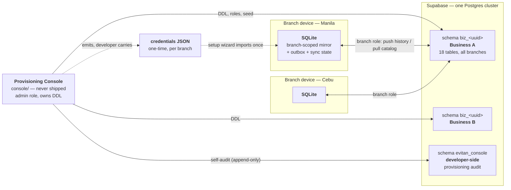
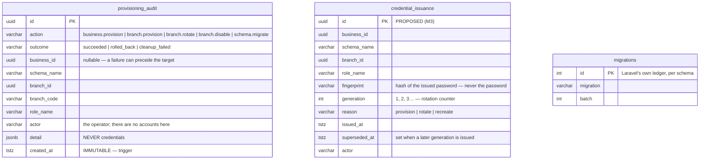
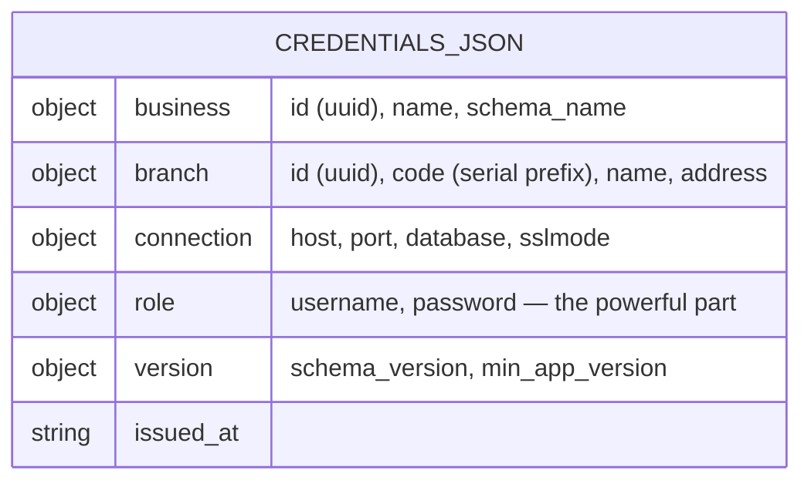
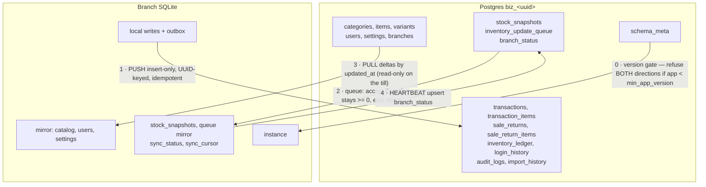

# Evitan Plus — data model ERDs

> Vision document. It draws the **four data stores** the Evitan Plus initiative spans, explains
> why each looks the way it does, and marks clearly what is **built** versus what is **proposed**
> for the phases still ahead.
>
> Authority: `MULTIBRANCH-BRAINSTORM.md` is the spec; where this document proposes something
> new (the local sync tables, the console registry additions) it is a **proposal for M5–M10**,
> not settled design. Everything marked *built* is read off the migrations in
> `console/database/migrations/` (M1) and `database/migrations/` (v1.0.0).

---

## 0. The stores at a glance

There is no single database. There are three schemas and one file-format contract, each with a
different owner, a different writer, and a different lifetime.

| Store | Owner / writer | Lifetime | Built? |
|---|---|---|---|
| `biz_<uuid>` Postgres schema | Console (DDL, seed) + branch roles (append) | permanent, authoritative | **built** (M1/M2) |
| `evitan_console` Postgres schema | Console admin connection only | permanent, developer-side | **built** (M2), extended below |
| Branch SQLite | The app on one device | disposable — rebuildable from Postgres | v1.0.0 shape built; sync tables **proposed** |
| Credentials JSON | Console emits, wizard consumes | one-time, deleted after import | **built** (M2 emits) |

The asymmetry is deliberate: **the SQLite file is the only store that can be thrown away.**
Every design decision below follows from that — anything a branch produces must reach Postgres,
and anything a branch merely reads must be re-derivable by a re-hydrate.

---

## 1. ERD — the per-business Postgres schema (`biz_<32-hex>`)

**Status: built** (`console/database/migrations`, 19 migrations, schema version 1).
One schema per business, holding **every branch** of that business.

```mermaid
erDiagram
    branches ||--o{ transactions : scopes
    branches ||--o{ inventory_ledger : scopes
    branches ||--o{ stock_snapshots : scopes
    branches ||--o{ sale_returns : scopes
    branches ||--o{ login_history : scopes
    branches ||--o{ audit_logs : scopes
    branches ||--o{ import_history : scopes
    branches ||--o{ inventory_update_queue : targets
    branches ||--|| branch_status : "heartbeat"

    categories ||--o{ items : groups
    items ||--o{ variants : "has 1..n"

    variants ||--o{ transaction_items : "sold as"
    variants ||--o{ inventory_ledger : moves
    variants ||--o{ stock_snapshots : "stock of"
    variants ||--o{ sale_return_items : "returned as"
    variants ||--o{ inventory_update_queue : adjusts

    transactions ||--o{ transaction_items : contains
    transactions ||--o{ sale_returns : "reversed by"
    sale_returns ||--o{ sale_return_items : contains
    transaction_items ||--o{ sale_return_items : "returned from"

    users ||--o{ transactions : "sold by"
    users ||--o{ inventory_ledger : "performed by"
    users ||--o{ sale_returns : "performed by"
    users ||--o{ login_history : "session of"
    users ||--o{ audit_logs : "acted"
    users ||--o{ import_history : "imported by"
    users ||--o{ inventory_update_queue : "issued by"

    schema_meta {
        smallint id PK "check id = 1 (singleton)"
        int schema_version "the version gate"
        varchar min_app_version "refuse sync below this"
        tstz applied_at
    }
    branches {
        uuid id PK
        varchar code UK "upper-case, serial prefix e.g. MNL"
        varchar name
        text address
        tstz disabled_at "null = active"
        tstz created_at
        tstz updated_at
    }
    users {
        uuid id PK
        varchar name
        varchar username UK
        varchar password "hash — mirrored to every device"
        varchar role "owner | admin | cashier"
        bool must_change_password
        tstz deleted_at "soft delete; partial UK: one live owner"
        tstz created_at
        tstz updated_at
    }
    categories {
        uuid id PK
        varchar name
        tstz archived_at "never deleted"
        tstz created_at
        tstz updated_at
    }
    items {
        uuid id PK
        varchar name UK "unique on lower(name), incl. archived"
        varchar unit
        uuid category_id FK "nullable, null-on-delete"
        text description
        tstz archived_at
        tstz created_at
        tstz updated_at
    }
    variants {
        uuid id PK
        uuid item_id FK
        varchar name "null = the unnamed single variant"
        varchar sku UK "check sku = upper(sku)"
        varchar barcode UK "partial UK — unique when present"
        numeric selling_price
        numeric cost "Owner-only at the app layer"
        int low_stock_threshold
        tstz archived_at
        tstz created_at
        tstz updated_at
    }
    settings {
        uuid id PK
        varchar key UK "business identity, tz, currency"
        text value
        tstz created_at
        tstz updated_at
    }
    transactions {
        uuid id PK
        uuid branch_id FK
        varchar transaction_number "UK per (branch_id, number) — MNL-0000000001"
        varchar payment_type
        numeric discount
        varchar discount_type
        numeric total
        numeric cash_received
        numeric change
        uuid user_id FK
        text comment
        tstz created_at "IMMUTABLE — trigger"
    }
    transaction_items {
        uuid id PK
        uuid transaction_id FK
        uuid variant_id FK
        int quantity
        numeric selling_price "snapshotted at sale"
        numeric cost "snapshotted at sale"
        numeric discount
        numeric total
        tstz created_at "IMMUTABLE — trigger"
    }
    inventory_ledger {
        uuid id PK
        uuid branch_id FK
        uuid variant_id FK
        int quantity "signed: +restock, -sale"
        int resulting_snapshot "check >= 0 — no negative stock"
        varchar type "sale|return|defect|restock|adjustment|import"
        varchar sale_type
        uuid reference_id "polymorphic"
        varchar reference_type
        text notes
        uuid performed_by FK
        tstz created_at "IMMUTABLE — append-only"
    }
    stock_snapshots {
        uuid id PK
        uuid branch_id FK
        uuid variant_id FK "UK (branch_id, variant_id)"
        int quantity "check >= 0 — reconciled, per branch"
        tstz created_at
        tstz updated_at
    }
    sale_returns {
        uuid id PK
        uuid branch_id FK
        varchar return_number
        uuid transaction_id FK
        varchar type "return | defect"
        text reason
        varchar refund_payment_type
        numeric total_refund
        uuid performed_by FK
        tstz created_at "IMMUTABLE — trigger"
    }
    sale_return_items {
        uuid id PK
        uuid sale_return_id FK
        uuid transaction_item_id FK "ties back to the priced line"
        uuid variant_id FK
        int quantity
        numeric selling_price
        numeric cost
        numeric refund_amount
        tstz created_at "IMMUTABLE — trigger"
    }
    login_history {
        uuid id PK
        uuid branch_id FK
        uuid user_id FK
        varchar event_type "login | logout | failed"
        tstz occurred_at
        text notes
        tstz created_at "IMMUTABLE — trigger"
    }
    audit_logs {
        uuid id PK
        uuid branch_id FK
        uuid user_id FK "nullable"
        varchar action
        varchar auditable_type
        uuid auditable_id
        text description
        text old_values
        text new_values
        tstz created_at "IMMUTABLE — trigger"
    }
    import_history {
        uuid id PK
        uuid branch_id FK
        uuid user_id FK
        varchar filename
        varchar mode
        varchar status
        int total_rows
        int success_count
        int error_count
        text errors
        tstz created_at
        tstz updated_at
    }
    inventory_update_queue {
        uuid id PK
        uuid branch_id FK "the branch that must validate it"
        uuid variant_id FK
        int quantity "signed; subtractive ones are the risky case"
        text notes
        varchar status "pending | accepted | rejected"
        text rejection_reason
        uuid ledger_entry_id "set only when accepted"
        uuid issued_by FK
        tstz resolved_at "check: (status = pending) = (resolved_at is null)"
        tstz created_at
        tstz updated_at
    }
    branch_status {
        uuid branch_id PK "one row per branch"
        varchar app_version
        int schema_version
        tstz last_sync_at
        int unsynced_count "check >= 0"
        tstz last_seen_at
        varchar connection_state
        text last_error
        tstz created_at
        tstz updated_at
    }
```

### Why it looks like this

**One schema per business, not one database per business, and not a `business_id` column.**
A `business_id` column on shared tables would make cross-tenant leakage a query-writing mistake
away. A schema boundary makes it a **grant** — a branch role has `USAGE` on exactly one schema
and no other, so the isolation survives any application bug. One database per business would
have cost a connection pool and a migration run per tenant for the same guarantee.

**`branch_id` is the only column Postgres adds to the mirrored tables.** It appears on nine
tables and nowhere else. Everything that is *business-wide* — the catalog (`categories`, `items`,
`variants`), `users`, `settings` — deliberately has no `branch_id`: one catalog, one user roster,
one set of settings, shared by every branch. Everything that *happened somewhere* carries it.
That single column is what turns the v1.0.0 single-install schema into a multi-branch one, and it
is why `SchemaParityTest::POSTGRES_ONLY_COLUMNS` is exactly `['branch_id']`.

**Three table classes, and the class decides everything** — sync direction, grants, and whether
conflicts are even possible:

| Class | Tables | Written by | Grants to a branch role |
|---|---|---|---|
| Online-authoritative | `categories`, `items`, `variants`, `users`, `settings`, `branches` | online only (in-app admin while connected) | `SELECT` only |
| Local-write, append-only | `transactions`, `transaction_items`, `sale_returns`, `sale_return_items`, `inventory_ledger`, `login_history`, `audit_logs`, `import_history` | the till, then pushed | `SELECT` + `INSERT` |
| Coordination | `stock_snapshots`, `branch_status` | both, additively | `SELECT` + `INSERT` + `UPDATE` |
| Coordination (mediated) | `inventory_update_queue` | HQ inserts, branch resolves | `SELECT` + column-level `UPDATE` on `status, resolved_at, rejection_reason, ledger_entry_id` |
| Never | `schema_meta` (SELECT only), `migrations` | console | no grant |

Because **every table has exactly one writer**, there is no last-write-wins anywhere and no
merge logic to get wrong. The single shared quantity — stock — reconciles *additively* (§10 of
the spec), never as a conflicting edit.

**No `DELETE` grant at all, plus triggers on top.** Grants stop a branch deleting history;
the `evitan_reject_mutation()` trigger on the seven immutable tables (`transactions`,
`transaction_items`, `inventory_ledger`, `sale_returns`, `sale_return_items`, `login_history`,
`audit_logs`) also stops the *console's* admin connection, which grants cannot — a superuser
bypasses grants entirely. Immutability is therefore enforced twice, at different layers, against
different threats.

**The uniqueness rules encode business invariants directly.**
`users_single_owner` is a partial unique index on `((true)) where role = 'owner' and deleted_at
is null` — "exactly one Owner" as a database fact, not an application convention.
`items_name_unique` is on `lower(name)` so case-insensitivity spans archived items.
`variants_barcode_unique` is partial (`where barcode is not null`) because a blank barcode must
never block selling. `transactions_branch_number_unique` is on `(branch_id, transaction_number)`,
not on the number alone: **the serial is per-branch**, and business-wide uniqueness comes from
the branch-code prefix.

**`resulting_snapshot >= 0` on the ledger and `quantity >= 0` on snapshots** are where the
"negative inventory is never allowed" invariant becomes physically impossible rather than merely
guarded — which matters precisely because a till may be pushing hours-old offline movements.

**`inventory_update_queue` is the answer to the one genuinely hard problem.** HQ wants to
subtract stock from a branch; the branch may have unsynced sales HQ cannot see. Applying the
adjustment directly could drive reconciled stock negative. So an online adjustment is *not* a
ledger entry — it is a **pending proposal**, and only the branch, which alone knows its true
reconciled stock, converts it into a ledger entry (`accepted`, with `ledger_entry_id` set) or
refuses it (`rejected`, with a reason surfaced in the in-app admin). The
`(status = 'pending') = (resolved_at is null)` check makes "resolved but no timestamp" and
"pending but timestamped" unrepresentable, which matters because the branch replays on
`status = 'pending'` alone.

**`schema_meta` is a singleton by check constraint** (`check (id = 1)`). A second row would make
"the schema version" ambiguous at exactly the moment a branch is deciding whether it is safe to
sync — the worst possible time for ambiguity.

---

## 2. ERD — the branch device's local SQLite

**Status: the mirror is built (v1.0.0); everything in the "instance & sync" group is proposed
for M5–M9.** Path `database/nativephp.sqlite`, one per device, one device per branch.

```mermaid
erDiagram
    categories ||--o{ items : groups
    items ||--o{ variants : "has 1..n"
    variants ||--o{ transaction_items : "sold as"
    variants ||--o{ inventory_ledger : moves
    variants ||--|| stock_snapshots : "stock of"
    variants ||--o{ sale_return_items : "returned as"
    variants ||--o{ inventory_update_queue : adjusts
    transactions ||--o{ transaction_items : contains
    transactions ||--o{ sale_returns : "reversed by"
    sale_returns ||--o{ sale_return_items : contains
    transaction_items ||--o{ sale_return_items : "returned from"
    users ||--o{ transactions : "sold by"
    users ||--o{ inventory_ledger : "performed by"
    users ||--o{ sale_returns : "performed by"
    users ||--o{ login_history : "session of"
    users ||--o{ audit_logs : acted

    instance ||--|| instance_secret : "credentials for"
    instance ||--o{ sync_cursor : "pull position"
    sync_outbox }o--|| instance : "pushed as"

    instance {
        int id PK "check id = 1 — singleton (NEW)"
        uuid business_id "from the credentials JSON"
        varchar schema_name "biz_xxxx"
        uuid branch_id "stamped onto every pushed row"
        varchar branch_code "serial prefix — MNL"
        varchar branch_name
        int schema_version "last verified against schema_meta"
        varchar min_app_version "the gate the app must clear"
        tstz hydrated_at "null until M5 hydration completes"
        tstz created_at
        tstz updated_at
    }
    instance_secret {
        int id PK "check id = 1 — singleton (NEW)"
        text dsn_ciphertext "pg host/port/db/user/password, sealed with per-install APP_KEY"
        varchar fingerprint "hash of the credential — matches console issuance"
        tstz imported_at
        tstz rotated_at
    }
    sync_outbox {
        int sequence PK "autoincrement — strict FIFO push order (NEW)"
        uuid id "the row's own uuid — idempotency key"
        varchar table_name "pointer, not payload"
        uuid group_id "one sale = one atomic push batch"
        int attempts
        text last_error
        datetime last_attempt_at
        datetime synced_at "null = unsynced; count = unsynced_count"
        datetime created_at
    }
    sync_cursor {
        varchar table_name PK "one row per pulled table (NEW)"
        datetime pulled_through "max updated_at applied"
        datetime last_pulled_at
    }
    sync_status {
        int id PK "check id = 1 — singleton (NEW)"
        datetime last_sync_at
        datetime last_probe_at
        varchar connection_state "online | offline | unauthorized | version_blocked"
        varchar last_error_kind "auth | version | network | conflict"
        text last_error
        datetime blocked_since
    }
    inventory_update_queue {
        uuid id PK "branch-scoped mirror of the queue rows (NEW)"
        uuid variant_id FK
        int quantity
        varchar status "pending | accepted | rejected"
        text rejection_reason
        uuid ledger_entry_id
        datetime resolved_at
        datetime acknowledged_at "Owner dismissed the in-app flag"
    }
    users {
        uuid id PK
        varchar username UK
        varchar password "ALL business users — any user, any branch, offline"
        varchar role
        bool must_change_password
        datetime deleted_at
    }
    categories {
        uuid id PK
        varchar name
        datetime archived_at
    }
    items {
        uuid id PK
        varchar name UK
        varchar unit
        uuid category_id FK
        datetime archived_at
    }
    variants {
        uuid id PK
        uuid item_id FK
        varchar name
        varchar sku UK
        varchar barcode UK
        numeric selling_price
        numeric cost
        int low_stock_threshold
        datetime archived_at
    }
    settings {
        uuid id PK
        varchar key UK
        text value
    }
    transactions {
        uuid id PK
        varchar transaction_number UK "MNL-0000000001 — generated locally"
        varchar payment_type
        numeric discount
        numeric total
        uuid user_id FK
        datetime created_at
    }
    transaction_items {
        uuid id PK
        uuid transaction_id FK
        uuid variant_id FK
        int quantity
        numeric selling_price
        numeric cost
        numeric total
    }
    inventory_ledger {
        uuid id PK
        uuid variant_id FK
        int quantity
        int resulting_snapshot
        varchar type
        uuid reference_id
        varchar reference_type
        uuid performed_by FK
        datetime created_at
    }
    stock_snapshots {
        uuid id PK
        uuid variant_id UK "this branch's stock only"
        int quantity
    }
    sale_returns {
        uuid id PK
        varchar return_number UK
        uuid transaction_id FK
        varchar type "return | defect"
        numeric total_refund
        uuid performed_by FK
    }
    sale_return_items {
        uuid id PK
        uuid sale_return_id FK
        uuid transaction_item_id FK
        uuid variant_id FK
        int quantity
        numeric refund_amount
    }
    login_history {
        uuid id PK
        uuid user_id FK
        varchar event_type
        datetime occurred_at
    }
    audit_logs {
        uuid id PK
        uuid user_id FK
        varchar action
        varchar auditable_type
        uuid auditable_id
        datetime created_at
    }
    import_history {
        uuid id PK
        uuid user_id FK
        varchar filename
        varchar status
    }
```

### Why it looks like this

**The mirrored tables keep their v1.0.0 shape, minus `branch_id`.** This is the single most
important property of the local schema: the till's tables are the *same* tables, so every model,
policy, report and test written across 19 phases keeps working untouched. A device holds only its
own branch's rows, so a `branch_id` column would be a constant on every row — dead weight that
also invites branch-scoped queries the till can never need. `branch_id` is stamped **at push
time** from `instance`, which is the one place it lives locally.

**The one exception to branch-scoping is `users`.** Every device caches *all* business users
including password hashes, because the requirement is that any user can log in at any branch
**offline**. That is a deliberate trade: a stolen device exposes the business's password hashes,
which is why they stay hashes and why the DB credentials next to them are encrypted.

**`instance` is a singleton, and it is not `settings`.** The obvious place for "which branch am
I" is the `settings` table — but `settings` is *mirrored and pulled from Postgres*, so a local
write there would be overwritten by the next pull, or worse, pushed and become another branch's
setting. Branch identity is local-only, arrives from the credentials JSON, and belongs in its own
table. The `check (id = 1)` singleton makes "two identities on one device" unrepresentable.

**`instance_secret` is split from `instance` for exposure, not normalization.** `branch_code` is
read on every checkout (it prefixes the serial); the sealed DSN is read only when a sync cycle
opens a connection. Separating them means the hot path never loads ciphertext into memory, and
rotation replaces exactly one row. The `fingerprint` column lets the console answer "is this
device still holding the credential I last issued?" without either side ever transmitting the
password.

**The outbox stores pointers, not payloads.** Every local-write table is immutable, so a row can
be re-read at push time and *cannot* have changed since it was queued — a copied payload would
add a second representation that can only ever drift. `sequence` is an autoincrement integer, not
a UUID, because the outbox needs **strict FIFO** and a UUID gives no order. `group_id` batches a
sale's rows (transaction + items + ledger entries) so they land in Postgres inside one
transaction; a partially-pushed sale would be visible to consolidated reporting as a sale with
missing lines. `synced_at IS NULL` is the definition of `unsynced_count` in `branch_status` —
one place, no counter to drift.

**Cursors are per table, not one global watermark.** `sync_cursor` keyed by `table_name` means a
failure pulling `variants` does not roll back the progress made on `users`, and a newly added
mirrored table starts from zero without re-pulling everything else.

**`sync_status` is where "why is it not syncing" lives.** The distinction between
`unauthorized` (role disabled by the console), `version_blocked` (the gate refused; app must
update) and `network` matters enormously to the person standing at the till — all three look
identical without it, and only one of them is fixed by waiting. None of them stop selling.

**The local `inventory_update_queue` mirror is a proposal with a cost.** The spec lists this
table as Postgres-only "coordination, not branch data", and `SchemaParityTest::POSTGRES_ONLY`
records that. But a rejected adjustment must be **visible in the in-app admin**, including after
the branch goes offline again — so the branch needs a local copy of the rows it resolved, plus an
`acknowledged_at` that exists only locally (dismissing a flag is not business history). Adopting
this means moving `inventory_update_queue` out of `POSTGRES_ONLY` and either into `MIRRORED`
(accepting that Postgres has `branch_id` and `issued_by` the till may not carry) or into a new
`SQLITE_LOCAL_ONLY` allowlist. **My recommendation: a third allowlist**, because the local table
is intentionally a *different, narrower* table, not a mirror — pretending otherwise would make
the parity test enforce a similarity that is not wanted.

**The serial generator needs a real change in M6, not a cosmetic one.**
`TransactionNumberGenerator` today does `(int) max(transaction_number) + 1`. Once the number is
`MNL-0000000001`, `(int)"MNL-…"` is **0**, and every sale would try to claim serial 1. The
generator must strip the prefix from the max, or — better — store the numeric serial separately
from the rendered number. Worth flagging now because it fails silently into a unique-constraint
retry loop rather than an obvious error.

**Local infrastructure tables** (`sessions`, `cache`, `cache_locks`, `jobs`, `job_batches`,
`failed_jobs`, `migrations`) are deliberately omitted from the diagram: they are Laravel's, never
synced, and rebuilt by a re-install.

---

## 3. ERD — the console's own schema (`evitan_console`)

**Status: `provisioning_audit` is built (M2); `credential_issuance` is proposed for M3.**
This schema lives outside every business schema. No branch role can reach it.

### Why it looks like this

**It is a separate schema, not a table inside a business schema.** Three reasons, and each one
alone would be sufficient. (1) A provisioning event happens *before* the schema exists, and
sometimes *fails* before it exists — there is no `biz_…` to write it to. (2) `audit_logs` is
branch-scoped business history that tills push upward; provisioning is neither. (3) The parity
and invariants tests enumerate exactly which tables a business schema may contain, and an extra
one would break them for no gain.

**`outcome` is a first-class column, not a `detail` key.** The question this trail exists to
answer is "which provisions failed and left something behind" — a half-created schema, an
orphaned role. That must be an indexed query, not a JSON scan, precisely on the day something is
broken.

**Every target column is nullable, and that is the point.** A provision that dies during
migration still owes an entry naming what it was attempting. A trail that can only record
successes is not a trail.

**It is append-only, enforced by the same `evitan_reject_mutation()` trigger** used in the
business schemas — and here the trigger is doing real work, because the *only* connection that
ever reaches this schema is the admin one, which grants would never constrain. An audit trail the
tool writing it can also rewrite is not an audit trail.

**`credential_issuance` (proposed) closes the rotation loop.** Today, rotation is
"fresh AppImage + new JSON" (§9), and nothing records what was issued to whom. Storing a
**fingerprint** — never the password — plus a `generation` counter lets the console answer two
questions it currently cannot: *is the credential this branch is using the current one?* (compare
against `instance_secret.fingerprint`, which the branch can safely report in its heartbeat), and
*how many times has this branch been re-issued?* `superseded_at` makes an old JSON found on a
desk identifiable as stale.

**There is deliberately no `businesses` registry table.** The console discovers businesses by
enumerating `biz_*` schemas and reads their identity from each schema's own `settings` and
`branches`. A registry would be a **second source of truth** that can silently disagree with
reality — a schema created but not registered, or registered but dropped — and the failure mode
is the console confidently reporting on a business that does not exist. Enumeration is slightly
slower and always right. This is a decision worth re-examining only if the monitor's cross-schema
fan-out (M10) becomes measurably slow at scale.

---

## 4. The credentials JSON — the fourth "schema"

Not a database, but a versioned data contract between two apps that never share code, which
makes it every bit as much a schema. **Status: built (M2 emits it); consumed by M5.**

**It carries exactly what the wizard needs to become a branch, and nothing else.** Notably it
carries the **version pair**, so a device can refuse a mismatched schema *before* writing
anything, and the **branch code**, because the serial prefix must be available offline forever
after — it cannot be fetched at checkout time.

**It is one-time by design.** After import the wizard seals the credentials with the per-install
`APP_KEY` (already generated per install, and in `cleanup_env_keys` so it never ships) and prompts
to delete the file. The plaintext credential should not outlive the install.

**Its lifecycle is the reason rotation is a re-delivery, not an API call.** There is no
bootstrap channel a console could use to hand a branch a new password — and adding one would mean
every device permanently holds a credential capable of fetching credentials. Fresh AppImage + new
JSON keeps the powerful secret on a path a human controls. (§19 defers automating this.)

---

## 5. Sync direction map

The ERDs above say what exists; this says which way each table moves. It is the diagram to check
before adding any table.

**The cycle order is load-bearing, not arbitrary.** Push runs *first* so that when the stock
baseline is pulled, Postgres has already recomputed with this branch's own movements included;
pulling first would hand the till a baseline it then has to correct by hand. The queue runs
*after* push for the same reason — an adjustment can only be validated against true reconciled
stock once the real, already-happened movements have landed. The heartbeat runs *last* so
`unsynced_count` and `last_error` describe the cycle that just finished.

**The version gate sits before all four steps and blocks both directions.** A stale push would
write old-format rows into a migrated Postgres; a new-format pull would write columns the local
SQLite does not have. Both are corruption, and refusing is the only safe move — while the till
keeps selling, which is the whole point.

---

## 6. What this vision implies for work already done

| Change | Where | Why |
|---|---|---|
| `transaction_number` gains a branch prefix | `TransactionNumberGenerator`, M6 | `(int)"MNL-…"` is 0 — silent serial collision, not an error |
| Local `transactions.transaction_number` unique index stays | local schema | still correct: one branch per device |
| Third parity allowlist (`SQLITE_LOCAL_ONLY`) | `SchemaParityTest` | `instance`, `sync_outbox`, `sync_cursor`, `sync_status`, local queue mirror have no Postgres counterpart *by design* |
| `inventory_update_queue` leaves `POSTGRES_ONLY` | `SchemaParityTest` | the branch needs an offline-visible copy of rejections |
| Grants must be re-applied after every migration | M9, `BranchRole::reapplyGrants()` | M2 grants per table; a new table is invisible to every branch role until re-granted |
| `credential_issuance` + heartbeat fingerprint | M3 / M10 | lets the console detect a branch running a superseded credential |

---

*Sources: `console/database/migrations/` (M1 Postgres schema, built), `console/database/
migrations-admin/` (M2 console schema, built), `database/migrations/` (v1.0.0 local schema, built),
`MULTIBRANCH-BRAINSTORM.md` §5–§18, `MULTIBRANCH-ROADMAP.md` M3–M12. Items marked NEW/PROPOSED are
this document's design proposals for M5–M10 and are not yet implemented.*
